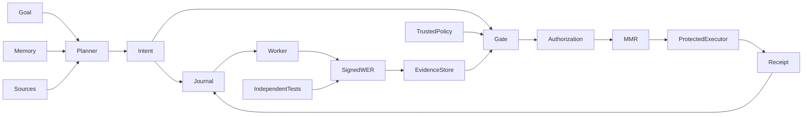

# Architecture

The provider proposes work; the local kernel authorizes protected execution. No provider adapter receives authority to bypass policy.

The crates form an acyclic dependency graph rooted in `agi-coder-core`. Cognition, verification, research, and memory are independently usable. The pipeline composes the journal, evidence store, gate, and MMR. The external adapter entry is the MCP stdio server. It has no gate override. The Jules client remains in the tree and is not offered by `agi.exe`. The `agi` binary wires a visibly synthetic offline demonstration and a loopback operator page. Callers can implement `Worker` and `ProtectedExecutor` for real integrations. The page cannot authorize host commands.

An operation ID identifies the replay slot using action type, target, and request identity. A separate intent digest binds requester and canonical parameters as well. This split makes changed parameters an idempotency conflict rather than an opportunity to execute again. Admission time is excluded so a later retry can match the original request.

WER hashes include exact operation and intent digests, predecessor, worker, plan, output, tests, test-artifact hash, self-check, completion time, and signer key. The signature and record hash are excluded from their own preimage. The signer normalizes self-check from test counts; verification rejects inconsistent fields. None of this transforms untrusted test claims into ground truth. Runtime keys, independently selected tests, and exact artifact handling must be controlled by the host.

The gate returns an `Authorization` with private fields. The executor consumes that capability rather than an unchecked Boolean. An allow decision requires trusted signer and requester, allowed action type, valid signature and digest, exact intent and output bindings, a nonempty all-passing test result, and freshness. Unknown or missing evidence denies authorization.

The pipeline anchors authorized evidence before calling the protected executor. Replays return the original response without worker dispatch. Remote worker errors and executor errors are conservatively treated as uncertain outcomes requiring reconciliation. Failed gate checks are terminal failures. Automatic crash recovery and cross-process atomicity require a durable journal/outbox design that is outside this implementation.

The Rust and TypeScript implementations verify the same independently authored Python MMR vectors. The WER fixture is a static Rust regression vector and is explicitly not an independent cryptographic implementation.

The inference layer is `agi-coder-inference`: a replaceable provider interface and an offline DeepInfer subprocess client. Cognition can request a draft for a ready task without changing its status. The client records request/response/artifact digests and explicitly returns `verified: false`. A trusted pipeline worker must still independently verify the exact candidate and produce a signed WER. Model text never authorizes its own execution. The Python bridge uses upstream `LLM.generate` and `SamplingParams`, not an assumed HTTP server. See [the DeepInfer integration guide](../integrations/deepinfer/README.md).
