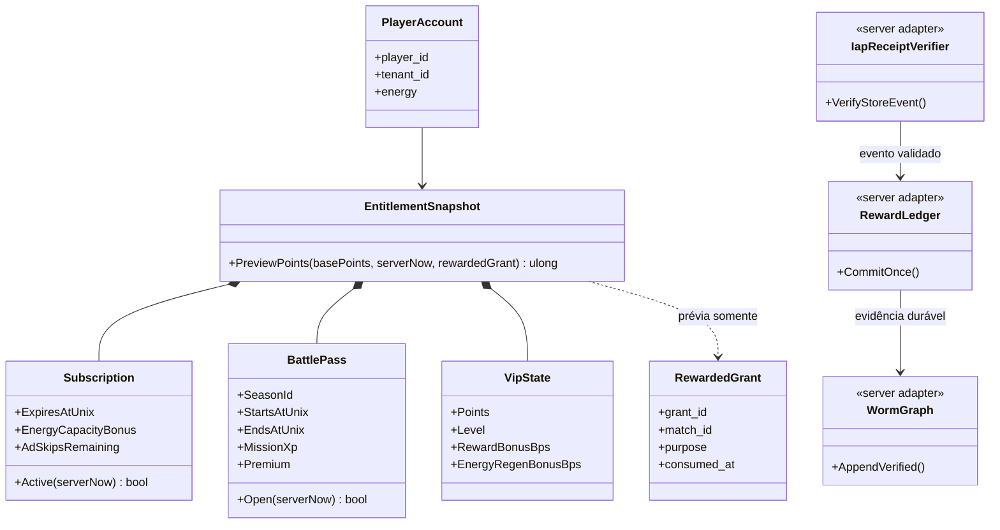

# Monetização: modelo de leitura

As três classes de direito são imutáveis no C#; ainda são dados do cliente,
portanto servem apenas à UI. Snapshot autenticado e relógio de servidor são
obrigatórios em produção. `PlayerAccount`, concessão de anúncio e adaptadores
externos estão no diagrama como arquitetura futura, não como implementação.

Política igual ao Rust anterior: base × 2 se assinatura ativa × 2 se concessão
premiada válida × (10000 + VIP bps) / 10000, arredondado para baixo. Soma ou
multiplicação que excede u64 rejeita. Assinatura ativa amplia capacidade de
energia, remove anúncios obrigatórios e disponibiliza ad-skips do catálogo.
Regeneração e saldos continuam no servidor. VIP ganha pontos por evento único
de compra/renovação validada; refunds geram eventos compensatórios.

Passe tem janela UTC de 30 dias com limite final exclusivo; missão diária ou
semanal valida XP. Claim único por jogador/temporada/trilha/marco. Anúncio ou
ad-skip produz uma concessão consumível para dobrar pontos OU reviver uma vez
com ceil(HP_max/2). Não conceder ambas as opções no mesmo grant. Webhooks
repetidos, retries e callbacks atrasados não devem duplicar saldo/direitos.

Não há loja, SDK de anúncios, callbacks simulados de sucesso ou botão que
conceda saldo neste benchmark. Tela de Hangar, árvore de atributos, energia,
temporadas e compras reais são etapas posteriores ao teste de gameplay.
