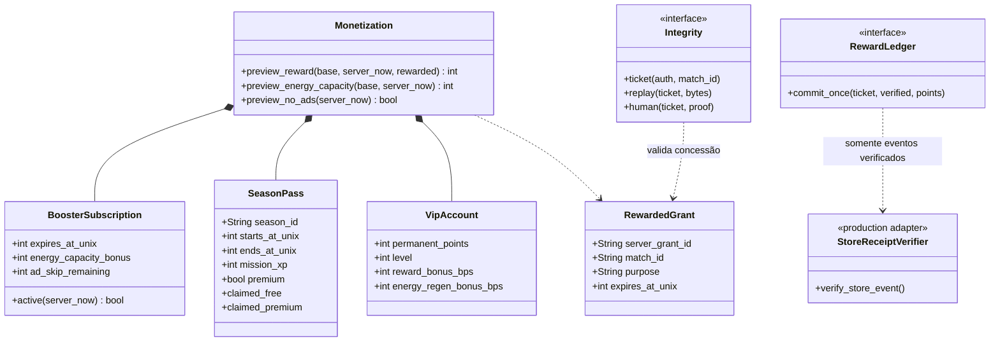

# Monetização e progressão

Estado no cliente serve à apresentação. Relógio, saldo, VIP, assinatura, XP e
concessões vêm de snapshots autenticados do servidor. Não existe compra ou
crédito de produção no protótipo.

Política v1: base = segundos completos + ondas × 25 + absorvidos × 2 + chefes × 500.
Assinatura ativa multiplica por 2; recompensa de anúncio multiplica por 2;
bônus VIP é aplicado por último em pontos-base (bps), arredondando para baixo.
Assim assinatura + anúncio = 4× antes do VIP. O servidor decide os direitos
conforme o snapshot do ticket da partida; não aceita multiplicadores do cliente.

Assinatura: capacidade diária maior (configuração do catálogo), sem anúncios
obrigatórios e créditos limitados de ad-skip. Ad-skip e callback premiado são
duas maneiras de obter a mesma concessão consumível, nunca duas recompensas.
VIP concede pontos por compra/renovação verificada; webhooks repetidos não
incrementam novamente. Revogações são eventos compensatórios, preservando
histórico, com política de estorno definida no catálogo do servidor.

Passe: janela de 30 × 86400 segundos em UTC, trilhas grátis e premium;
XP concedido apenas por missões diárias/semanais validadas. Claim único por
(tenant, jogador, temporada, trilha, marco). Compras não concedem XP de missão.
Renovação de assinatura usa o identificador único do período da loja.

Após derrota: dobrar recompensa OU reviver uma vez a 50% do HP máximo,
arredondado para cima. Reviver consome concessão antes de retomar o replay;
fechar a partida bloqueia novos revives. Anúncios exigem callback servidor a
servidor validado e vinculado a jogador/partida/finalidade, com expiração.
Falha/offline mantém pendente; nunca simular callback bem-sucedido.

Árvore planejada (ainda sem tela de Hangar): ataque (dano, cadência, spread,
canhões auxiliares), defesa (HP, escudo regenerativo, raio de absorção),
mobilidade (resposta do arraste, cooldown de dash). Catálogo versionado define
custos e limites; gasto e desbloqueio são transação única. Scrap valida-se
no replay e serve para reparos/módulos. Logs de rádio destravam no Hangar.
O protótipo demonstra coleta e cenário contínuo; não implementa esse catálogo.
