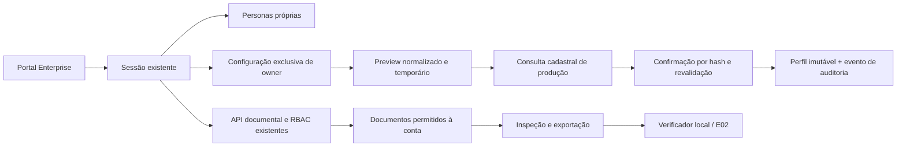

# Arkhe Enterprise — arquitetura canônica

Revisão: 2026-10-23. Referências visuais: `stitch_arkhe_enterprise_verification_platform/`.

## Stack e mapa executável

Versão documental: 1.0. O manifesto da aplicação fixa Next.js **15.5.28** e React **18.3.1**. O runtime validado é Node **24**, necessário ao uso de `node:sqlite` neste projeto; o Dockerfile usa Node 24 bookworm-slim e o toolchain Rust é **1.96.0**. Não há requisito de versão SQLite independente medido nesta revisão: usa-se a biblioteca incorporada ao runtime. SQLite opera em WAL, foreign_keys=ON e busy_timeout=5000, com uma conexão DatabaseSync por processo.

| Caminho real no workspace | Responsabilidade |
| --- | --- |
| [app/enterprise](../apps/arkhe-intra/app/enterprise/) | Rotas do portal |
| [components](../apps/arkhe-intra/components/) | Provider, dashboard, personas, onboarding e declaração |
| [lib/enterprise.mjs](../apps/arkhe-intra/lib/enterprise.mjs) | Catálogo/perfil, preferências, preview e commit |
| [lib/auth.mjs](../apps/arkhe-intra/lib/auth.mjs), [documents.mjs](../apps/arkhe-intra/lib/documents.mjs) | Sessões locais e autorização documental existentes |
| [lib/store.mjs](../apps/arkhe-intra/lib/store.mjs), [http.mjs](../apps/arkhe-intra/lib/http.mjs) | SQLite e dispatcher da API |
| [enterprise-cnpj.mjs](../apps/arkhe-intra/lib/enterprise-cnpj.mjs), [enterprise-resilience.mjs](../apps/arkhe-intra/lib/enterprise-resilience.mjs) | Cliente Serpro e proteção de chamadas |
| [enterprise-representation.mjs](../apps/arkhe-intra/lib/enterprise-representation.mjs) | Desafio, assinatura, processo Rust e recibo local |
| [kernel/arkhe-core](../kernel/arkhe-core/) | Kernel e tipos compartilhados |
| [evidence/arkhe-wormgraph](../evidence/arkhe-wormgraph/) | WormGraph e binário arkhe-representation-anchor |
| [verification/crates/arkhe-verify-core](../verification/crates/arkhe-verify-core/), [arkhe-verify-wasm](../verification/crates/arkhe-verify-wasm/) | Verificação nativa e WASM |
| [storage/sql/migrations](../storage/sql/migrations/) | 17 migrações SQL imutáveis do workspace; distintas do schema SQLite do portal |
| [specs/adr](specs/adr/), [validation](validation/) | Decisões locais e evidências por revisão |

O login atual usa contas/senhas e sessão existentes, sem integração gov.br/OIDC demonstrada. O estado da sessão chega à API; author/reviewer/owner continuam sendo os papéis. O código do kernel não depende do portal. A existência de ContainmentGate no workspace não significa que este onboarding faça admissão WER ou enforcement setorial: o recibo local da declaração explicitamente não faz isso.

## Tabelas e limites do armazenamento

| Tabela SQLite real | Contrato |
| --- | --- |
| documents | id PRIMARY KEY; documento serializado em value |
| events | Auditoria encadeada, seq e triggers append-only |
| sessions / login_attempts | Sessão por hash e controle de tentativas por subject |
| credential_invitations / credential_requests / enrolled_accounts | Convites, cadastro e contas; FK e UNIQUE onde declarados |
| enterprise_profile | id PRIMARY KEY com CHECK(id=1), triggers de imutabilidade |
| enterprise_previews | user_id PRIMARY KEY; um preview ativo por usuário |
| enterprise_preview_requests | PRIMARY KEY(user_id,request_key); replay vinculado a conteúdo e validade |
| enterprise_personas | user_id PRIMARY KEY; lista e persona ativa |
| enterprise_representation_challenges | user_id PRIMARY KEY; desafio temporário |
| enterprise_representations | id PRIMARY KEY, triggers de imutabilidade; recibo e base assinada |

Esta é uma seleção do schema, não todas as tabelas da aplicação. Não existem tabelas enterprise_audit ou enterprise_serpro_log neste fluxo, nem users/roles separadas no schema descrito pelo anexo. Eventos Enterprise reutilizam events. Não há tenant_id. O schema é inicializado aditivamente nos módulos existentes; as migrações SQL do workspace não devem ser confundidas com esse mecanismo.

## Decisão de integração

O produto executável é `apps/arkhe-intra` (Next.js, React, API Node e SQLite). A instalação é de uma organização: `canReadDocument`, sessões e papéis author/reviewer/owner já controlam os dados. O portal Enterprise passa a ser a rota autenticada `/enterprise`, acessível pela navegação existente. O onboarding está em `/enterprise/onboarding`. Não se cria um segundo login, uma segunda biblioteca nem um servidor com permissões divergentes.

O anexo mistura propostas futuras com componentes existentes. E02, exportação de evidências, assinatura Ed25519, auditoria encadeada e configuração Rekor já existem. Reutilizamos essas rotas. Os mocks contêm números, selos BACEN/ICP-Brasil, quórum HSM e status RBB que não constituem evidência da instalação. A implementação usa contagens reais filtradas pelo servidor e explicita integrações ausentes.

## Limites e decisões (ADR-008 a ADR-011)

- **008 — apresentação:** qualquer usuário pode escolher suas personas. A API continua autorizando cada leitura e ação pelo papel real. Trocar para Executivo ou Auditoria não concede governança. Não filtramos acesso por vocabulário ou departamento.
- **009 — perfil imutável:** um perfil de setor/versionamento é vinculado uma única vez à organização local. Um segundo commit retorna conflito. O catálogo é dado curado de produto, identificado por SHA-256; não é um artefato assinado pelo Arkhe nem atestação regulatória. Alterações exigem nova versão. Não há multi-tenancy real, migração de setor ou isolamento por tenant nesta entrega.
- **010 — preview antes do commit:** previews são por usuário. Um novo preview substitui somente o do mesmo usuário. A e B mantêm previews independentes; o primeiro commit válido vence, remove todos os previews e registra um evento. O segundo recebe 409. A consulta cadastral ocorre antes da transação, e o preview é revalidado após esse I/O. Hash é compromisso, não assinatura. Detalhes e cenário concorrente: [ADR-010](specs/adr/ADR-010-onboarding-preview-before-commit.md).
- **011 — múltiplas personas:** lista e persona ativa persistem por usuário no SQLite. Preferências não contêm papel, permissões, quota efetiva ou chave. O catálogo oferece oito departamentos, doze setores e fallback genérico.

## Contratos

Todos usam sessão existente e `Cache-Control: no-store`. POST mantém a validação de Origin e limite de corpo já implementados.

| API | Função | Autorização |
| --- | --- | --- |
| GET `/api/enterprise` | catálogo, perfil local e preferências próprias | autenticado |
| POST `/api/enterprise/personas` | salvar lista e persona ativa | próprio usuário |
| POST `/api/enterprise/preview` | validar empresa, setor, departamentos e integrações desejadas; preview expira em 15 min | owner |
| POST `/api/enterprise/commit` | consulta cadastral ativa, conferência de dados e vínculo único ao hash confirmado | owner |

O dashboard consome `/api/dashboard`, com os mesmos filtros de `canReadDocument`. Documentos, certificados, auditoria, credenciais, desenvolvimento e verificadores continuam em suas rotas atuais. Links de ações respeitam o papel para orientar a interface; a autorização efetiva permanece no servidor. Exportações JSON existentes mantêm seu significado; imprimir o resumo não produz PDF assinado ou certificado ICP-Brasil.

As oito personas têm focos próprios sobre dados existentes: assinaturas no Jurídico; etapas no Financeiro; fila de revisão em Compliance; ferramentas de verificação em Engenharia; tarefas em Operações; distribuição documental por departamento no Executivo; digests e laudos em Auditoria; autoria e assinaturas em RH/PI. A seleção não produz métricas de risco, custos, SLA ou pipeline que não tenham fonte disponível.

## Catálogo e políticas

Os presets são sugestões de configuração do documento de design. Retenção, revisão, quotas, HSM, e-CPF/e-CNPJ e âncoras do preset **não são controles executados** pelo fluxo documental atual. O onboarding grava a intenção e o portal mostra essa limitação. A [resolução CNAE](specs/CNAE-RESOLUTION.md) tem ordem explícita, primeiro match e fallback generic; UI e servidor compartilham o helper. A seleção manual prevalece.

O preview valida formato e dígitos do CNPJ numérico ou alfanumérico. O commit exige consulta cadastral de produção Serpro, ativa e coincidente com CNPJ, razão social e CNAE principal. Sem credenciais, divergência ou erro, falha sem gravar o perfil. [Configuração e limite de identidade](CNPJ-REGISTRY.md): cadastro consultado não prova representação legal. Não apresentamos políticas como aconselhamento legal ou garantia de conformidade.

## Fronteira vendor e CI local

`integrations/solana-proof` é um pacote Node de protótipo registrado. Seu checkout externo `output/meteora-dbc-program` está declarado por caminho exato em `vendor_roots`, com motivo e upstream. O checker impede exclusões que escondam membros ativos ou extrapolem a fronteira de referências; não ignora todos os diretórios output. Um teste verifica que novos crates vizinhos continuam visíveis. O lockfile inclui agora o importer Solana e passa a verificação frozen. Isso é evidência local; não se declara execução remota de CI.

## Próximos limites de produção

Para enforcement setorial será necessário vincular políticas à criação, revisão, armazenamento e publicação; implementar retenção/legal hold; verificar assinatura do catálogo por raiz de confiança; provisionar e atestar KMS/HSM; integrar RBB/ICP-Brasil; definir tenancy antes de expor instalações compartilhadas. Crates Rust novos só se justificam quando houver essas responsabilidades executáveis. Os módulos locais preservam uma futura extração sem criar bibliotecas vazias.

## Validação

Testes de API cobrem papéis, preview/commit concorrente A+B, gate cadastral com respostas sintéticas, isolamento de preferências e RBAC. Typecheck, build e suíte existente verificam integração. Chromium executou login, troca de persona, formulário de seis passos, bloqueio sem Serpro, inspeção e recuperação de erro, com 13 screenshots de desktop/mobile na revisão do piloto. A suíte atual tem 72 testes da aplicação; a revisão Linux de resiliência acrescenta oito verificações e três screenshots em execução separada. [Validação](VALIDATION.md) e [maturidade](MATURITY.md) separam estes resultados locais de operação externa e produção.

## Evolução para piloto interno (2026-10-23)

O commit agora exige também uma base de representação registrada pelo servidor. Na fase internal explicitamente habilitada, somente generic admite SelfDeclared: documentos obrigatórios conforme condição, assinatura Ed25519 da conta, registro com o WormGraph Rust e checkpoint local persistido no SQLite. O default external e os setores financeiro/saúde/governo recusam autodeclaração. PowerOfAttorney, ECnpj e Qsa permanecem pendentes e nenhum flag do cliente os habilita. O cadastro e a base de representação aparecem separadamente na governança. Ver [política](REPRESENTATION-POLICY.md).

Contratos adicionais: POST `/api/enterprise/representation/challenge` gera bytes vinculados a preview/conta/CNPJ/documentos; POST `/api/enterprise/representation/record` verifica assinatura e registra recibo. Ambos exigem owner e a validação Origin existente. Nenhum documento original ou chave privada é enviado. O recibo local não é WER admitido, âncora RBB/Rekor ou timestamp externo.

O novo binário reside no crate WormGraph existente; não adiciona crate ao workspace. O job de superfícies compila o binário antes dos testes Node. O [Dockerfile standalone](STANDALONE.md) compila em Linux e inclui os recursos dinâmicos WASM/E02 e o binário, mantendo dados fora da imagem. O perfil executado foi Podman rootless, não Docker Engine ou deploy público.

## Revisão de resiliência

A [revisão dos 50 tópicos](RESILIENCE-REVIEW.md) registra as cinco ações implementadas e corrige as ausências presumidas no parecer: BEGIN IMMEDIATE, WAL, foreign_keys, constraints e liveness já existiam. Retry limitado, circuit breaker, índices direcionados, readiness, supervisão do encerramento e idempotência do preview agora têm código e testes. O portal permanece single-org e não ganhou fila, Redis ou banco distribuído.

## Contratos de resiliência vigentes

O formulário envia Idempotency-Key ao POST /api/enterprise/preview; o header permanece opcional no servidor por compatibilidade. A resposta normalizada é persistida com a chave por usuário na mesma transação; replay reproduz a expiração original. Conteúdo divergente ou preview substituído retorna 409. Chaves diferentes não criam múltiplos previews ativos do mesmo usuário.

A consulta Serpro ocorre somente no commit, após verificar representação, fora da transação SQLite; em seguida perfil, preview, catálogo e representação são revalidados dentro dela. Preview tem hash, não assinatura. A seleção manual do setor prevalece sobre a sugestão CNAE. Não há fallback BrasilAPI para confirmar identidade.

Parâmetros reais: até três tentativas GET transitórias, backoff 200/400 ms com jitter, Retry-After limitado pelo orçamento, dez segundos globais, circuito após três operações transitórias falhas desde o último sucesso e abertura de 30 segundos, máximo de duas operações simultâneas. O POST de token não tem retry automático. Retry SQLite limita-se à aquisição BEGIN IMMEDIATE, com três tentativas totais; o callback não é repetido. [Revisão detalhada](RESILIENCE-REVIEW.md).

GET /api/health é liveness; GET /api/ready verifica acesso SQLite e FK, com 503 durante o marcador de drenagem. Ambos são endpoints operacionais sem sessão e não expõem dados de negócio. Readiness não depende de Serpro e não certifica poderes. O supervisor preserva o drain nativo Next e limita a espera a 20 segundos; stop timeout deve exceder esse prazo. Em produção, proxy/TLS e política de disponibilidade exigem validação própria.

Esta arquitetura faz parte dos [seis documentos canônicos](README.md#documentos-canônicos). A matriz dos 50 tópicos permanece em RESILIENCE-REVIEW.md; não se adota a divisão universal de “39 irrelevantes”. Pendências estão em [TASKS.md](TASKS.md) e evidência histórica em [PROGRESS.md](PROGRESS.md).

## Operação e recuperação

[observability.mjs](../apps/arkhe-intra/lib/observability.mjs) observa as respostas do dispatcher HTTP: logs JSON com operação gerada e contadores/histogramas de rotas limitadas. GET /api/metrics exige owner ou bearer dedicado; o Caddy público bloqueia a rota. Não há tenant_id, nova autenticação de usuário ou endpoint Prometheus público. A observação cobre o dispatcher, não toda renderização Next ou streaming completo; métricas reiniciam com o processo.

O startup SQLite verifica integridade antes de inicializar schema. [backup.mjs](../apps/arkhe-intra/scripts/backup.mjs) usa snapshot online, copia apenas SQLite e bootstrap accounts e verifica FKs/cadeia de auditoria. Restore exige diretório novo e limpa sessões. Isso não recupera chaves privadas, configuração/segredos externos ou mudanças posteriores ao snapshot. Templates Caddy e systemd são descritos no [runbook](RUNBOOK.md), com limites de validação em [INFRASTRUCTURE-REVIEW.md](INFRASTRUCTURE-REVIEW.md).
