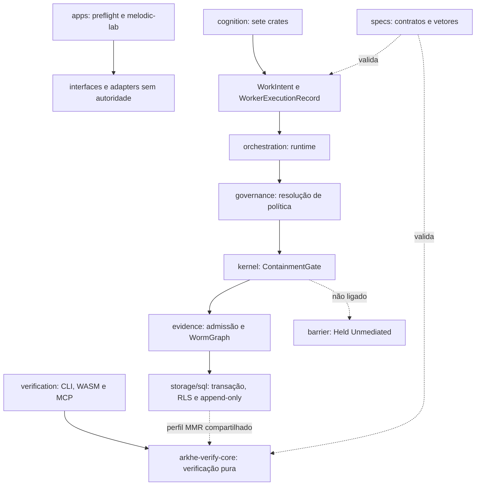

# Arquitetura unificada

A raiz é o ponto único de build, configuração, testes e operação. O workspace
Rust ativo e os pacotes Node editáveis estão listados em
[config/architecture.json](../config/architecture.json). Esse arquivo é o
registro; a contagem no texto não o substitui.

As linhas entre superfícies e adapters representam a direção arquitetural; não
atestam que todas as interfaces de demonstração já estejam ligadas ao runtime.
O estado de cada componente consta no registro e no STATUS. O MCP de verificação
é um adapter funcional WASM; `integrations/mcp-server` continua sendo um scaffold
de health, com `authority: "none"` e sem `decide_event`.

## Autoridades e dependências

| Autoridade | Fonte única ativa |
|---|---|
| WorkIntent / WER e preimages AKG-CBOR-v1 | `kernel/arkhe-core`; os dois tipos não são redefinidos noutros crates ativos |
| Autorização de transição | `kernel/arkhe-kernel` e `governance/arkhe-governance` |
| Veredito de política | tipo `PolicyVerdict` só em `governance/arkhe-governance`; cognição, evidência e verificação não emitem `Allow` |
| Decisão fail-closed de espécime | `kernel/arkhe-gate`, fora do caminho de `arkhe-kernel` |
| Verificação de artefatos | `verification/crates/arkhe-verify-core` |
| Perfil MMR executável | `arkhe-verify-core::mmr::profile`; SQL reexporta e não redefine |
| Esquema de persistência | `storage/sql/migrations`, com identidades em `config/migrations.lock.json` |
| Orquestração operacional | `scripts/live_runtime.py`, `ops/runtime/Dockerfile` |
| Inventário de camadas e superfícies | `config/architecture.json` |
| Dependências Rust / Node editáveis | `Cargo.lock` / `pnpm-lock.yaml` da raiz |

O núcleo de verificação não depende de HTTP, filesystem, PostgreSQL, relógio
nem do gate, e o código em `src` não constrói `Allow`. CLI, WASM, MCP e
Cosign permanecem adapters; um resultado de verificação não concede
autorização de transição. A cognição depende de contratos do core e não
recebe chave de assinatura nem dependência direta do WormGraph. A
especificação em `formal/spec` mantém `Unmediated` e não introduz `Released`.
O ficheiro `eval/verifiers/FROZEN` continua fora do write set do agente.

O fluxo operacional é proposta → WER → política → gate → commit de evidência.
`commit_proposed_work` grava WorkIntent, WER e envelope numa transação e
devolve um recibo. Esse recibo não lança processo nem chama a barreira.
O executor de preview corre Podman sob qualificação assinada. No crate do
runtime, `Command::new` só pode aparecer em `preview/executor.rs`. Esse
caminho não é a barreira e não está em `edges` como efeito. `decide_event`
só admite quando a razão é `RuleAllowed`. O `emergency_stop` é um bool
definido pelo chamador: a decisão passa a `Reject`. Esse bool não envia
sinal nem pára um grupo de processos. `AuthorizationDecision::Allow` é
construído uma vez, em `authorize_checked_with_proof`. O código de produção
em `cognition/` não contém `SigningKey`. Conflitos de identidade ou
referências ilegíveis falham; replay exato conserva o mesmo recibo.

A decisão que autoriza é `decide_event` em `kernel/arkhe-kernel`. `arkhe-gate`
é um espécime fail-closed e não está ligado a esse caminho.

## Esqueleto sem efeito

Estas pastas existem para separar limites que o build ativo ainda não cumpre.
Nenhuma delas solta efeito, retoma trabalho ou contém uma prova aceite.
Os crates desse limite estão em `skeleton_members`. A bancada de desenvolvimento
lê essa lista e não os trata como baseline de produto.

| Pasta | Contrato atual |
|---|---|
| `barrier/arkhe-barrier` | `admit` devolve `Held(Unmediated)`; `preempt` devolve `NotImplemented` |
| `state/arkhe-state` | `atomic` e `journal` existem como tipos; `resume` devolve `Unavailable(NotImplemented)` |
| `probes/arkhe-probes` | mede a barreira, a preempção e a retoma |
| `models/pins` e `models/client.toml` | cliente sem snapshot, sem chaves, sem evidência e sem efeito |
| `formal/` | `admit`, `resume` e `decide` por escrever; `proof/detinfer` com `SpecSafety` aceite pelo `tlapm`, ponte modelo↔hardware não aceite |
| `eval/` | tarefa por congelar; `verifiers/refuse.py` imprime `not scored` |

Estado de retoma, evidência e `kernel/arkhe-chain` permanecem distintos.
Consenso não é durabilidade. As arestas do fluxo estão em `edges`. A única
aresta que solta efeito é `barrier → world`, com estado `unwired`. O
`arkhe-kernel` não depende dos crates do esqueleto, e eles não dependem dele.
`dependency_walls` impede que cognição escreva evidência ou autorize, que
verificação autorize, que evidência chame cognição ou consenso, e que retoma
ou o consenso de produção sejam o gate. O consenso pode referir o gate só em
dependência de teste. O cliente em `models/pins` não assina. A tarefa em
`eval/tasks` permanece por congelar. `formal/proof/NONE` passou a registar um
teorema aceite: `DetInferProof.SpecSafety`, 133 obrigações descarregadas pelo
`tlapm`, não-limitado. O que o ficheiro continua a negar é a ponte
modelo↔hardware — `HashInjective` é um `ASSUME`, a pureza de `Infer` é uma
`CONJECTURE` — e é essa negação que `must_contain` fixa. A bancada recusa
evoluir um crate do esqueleto.

## Workspaces independentes

Árvores com `Cargo.toml` e `Cargo.lock` próprios ficam em
`independent_workspaces`. O verificador deixa de as tratar como membros do
build único. Entre elas estão a cópia nativa Salesforce, `work/a1-pr` e
`work/arkhe-chain-devnet`. Nenhuma substitui o crate ativo do mesmo nome.

## Pastas e contratos preservados

- `apps/preflight` e `apps/melodic-lab`: interfaces Angular com nomes distintos,
  portas de desenvolvimento 3000 e 3001 e lockfile pnpm comum.
- `integrations/verify-mcp`: carrega o WASM gerado em `verification/.../pkg`;
  o caminho pode ser explicitado por `ARKHE_VERIFY_WASM_MODULE`.
- `plugins/paybox`: pacote existente preservado, incluindo starter manifest,
  lockfile, protocolo e requisito Node 24 em Linux/macOS com pnpm 11.11.0.
  Não se altera esse contrato apenas para uniformizar a árvore de diretórios.
- `specs/akg`: candidato normativo B.0.2; a mudança de pasta não o torna congelado.
- `specs/mmr`: perfil congelado e referência independente; duplicatas documentais
  de vetores não são novas implementações autoritativas.
- `docs/normative-review`: revisão documental e proveniência das decisões.
- `design/stitch`: referências visuais, sem semântica de autorização.
- `archive/p0` e `archive/melodic-p0`: todas as versões anteriores e cópias de P0.
- `archive/phase-a-*`: snapshots alternativos com o mesmo nome de crate e contratos
  próprios de medição/preflight; preservados para integração futura deliberada.
- `archive/workspace-manifests`: definições anteriores de workspace e CI.

As versões históricas não entram no Cargo workspace nem nas imagens do runtime.
Não se mistura o esquema legado Phase A com as migrações já publicadas. O banco
existente e `ops/local/live.json` foram preservados na nova raiz operacional.
Os movimentos são registrados em `docs/architecture/moves.json` e
`additional-moves.json` e `operational-moves.json`; nada depende dos antigos nomes de pastas exportadas.

## Gates de alinhamento

`python scripts/check_architecture.py` compara `Cargo.toml` com
`rust_members`, os `package.json` com `node_packages`, e os `Cargo.toml`
descobertos com o workspace único depois de excluir `vendor_roots` e
`independent_workspaces`. Também exige nomes únicos, dependências locais dentro
da raiz, ausência dos workspaces e locks antigos, e hashes das migrações
publicadas. Os hashes dos scripts de migração são independentes da posição dos
arquivos e continuam compatíveis com SQLx.

O CI ativo é `.github/workflows/ci.yml`: núcleo e contratos, superfícies/WASM e
runtime persistente. O build comum não regenera vetores dourados. Os gates com
PostgreSQL habilitam os testes SQL originalmente ignorados e os executam contra
o login restrito, além do teste de rejeição de credenciais administrativas.

Identidade de trabalho mantém os 17 vetores Python/Rust. Verificação nativa
consome os vetores READY de artefatos e provas MMR; o adapter Node testa os
exports WASM com os vetores READY que expõe. C2PA-001 continua CANDIDATE e não é
promovido por testes de integração. Publicação Cosign, políticas Kubernetes e
conformidade de produção permanecem gates próprios, sem aprovação implícita.

O Compose local reúne PostgreSQL, runtime, Redis, health/metrics MCP, Prometheus e
Grafana; `scripts/full_stack.py` constrói e adota os containers de desenvolvimento
com o volume PostgreSQL preservado. A autoridade de verificação MCP continua no
adapter stdio, testado separadamente. Resultados executados, códigos de saída,
logs e identidades das fontes ficam em `docs/evidence/2026-10-17-execution/`.
