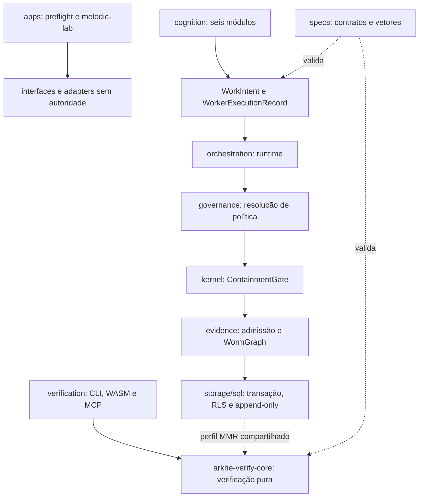

# Arquitetura unificada

A raiz é o ponto único de build, configuração, testes e operação. A reorganização
integra os crates atuais de kernel, SQL e verificação num workspace Rust de
19 pacotes e agrupa quatro pacotes Node editáveis num workspace pnpm.
O registro executável é [config/architecture.json](../config/architecture.json).

As linhas entre superfícies e adapters representam a direção arquitetural; não
atestam que todas as interfaces de demonstração já estejam ligadas ao runtime.
O estado de cada componente consta no registro e no STATUS. O MCP de verificação
é um adapter funcional WASM; `integrations/mcp-server` continua sendo um scaffold
de health, sem ferramentas MCP de autorização.

## Autoridades e dependências

| Autoridade | Fonte única ativa |
|---|---|
| WorkIntent / WER e preimages AKG-CBOR-v1 | `kernel/arkhe-core` |
| Autorização de transição | `kernel/arkhe-kernel` e `governance/arkhe-governance` |
| Verificação de artefatos | `verification/crates/arkhe-verify-core` |
| Perfil MMR executável | `arkhe-verify-core::mmr::profile`; SQL reexporta esta definição |
| Esquema de persistência | Oito arquivos em `storage/sql/migrations` |
| Orquestração operacional | `scripts/live_runtime.py`, `ops/runtime/Dockerfile` |
| Inventário de camadas e superfícies | `config/architecture.json` |
| Dependências Rust / Node editáveis | `Cargo.lock` / `pnpm-lock.yaml` da raiz |

O núcleo de verificação não depende de HTTP, filesystem, PostgreSQL ou relógio.
CLI, WASM, MCP e Cosign permanecem adapters; um resultado de verificação não
concede autorização de transição. A cognição depende de contratos do core e não
recebe chave de assinatura nem dependência direta do WormGraph.

O fluxo operacional é proposta → WER → política → gate → commit de evidência.
O runtime grava WorkIntent, WER e envelope numa transação antes de emitir um
recibo. Não executa efeitos externos. Conflitos de identidade ou referências
ilegíveis falham; replay exato conserva o mesmo recibo.

## Pastas e contratos preservados

- `apps/preflight` e `apps/melodic-lab`: interfaces Angular com nomes distintos,
  portas de desenvolvimento 3000 e 3001 e lockfile pnpm comum.
- `integrations/verify-mcp`: carrega o WASM gerado em `verification/.../pkg`;
  o caminho pode ser explicitado por `ARKHE_VERIFY_WASM_MODULE`.
- `plugins/paybox`: pacote existente preservado, incluindo starter manifest,
  lockfile, protocolo e requisito Node 24 em Linux/macOS com pnpm 11.11.0.
  Não se altera esse contrato apenas para uniformizar a árvore de diretórios.
- `specs/akg`: candidato normativo B.0.2; a mudança de pasta não o torna congelado.
- `specs/mmr`: perfil congelado e referência independente; duplicatas documentais
  de vetores não são novas implementações autoritativas.
- `docs/normative-review`: revisão documental e proveniência das decisões.
- `design/stitch`: referências visuais, sem semântica de autorização.
- `archive/p0` e `archive/melodic-p0`: todas as versões anteriores e cópias de P0.
- `archive/phase-a-*`: snapshots alternativos com o mesmo nome de crate e contratos
  próprios de medição/preflight; preservados para integração futura deliberada.
- `archive/workspace-manifests`: definições anteriores de workspace e CI.

As versões históricas não entram no Cargo workspace nem nas imagens do runtime.
Não se mistura o esquema legado Phase A com as migrações já publicadas. O banco
existente e `ops/local/live.json` foram preservados na nova raiz operacional.
Os movimentos são registrados em `docs/architecture/moves.json` e
`additional-moves.json` e `operational-moves.json`; nada depende dos antigos nomes de pastas exportadas.

## Gates de alinhamento

`python scripts/check_architecture.py` valida os 19 membros, quatro pacotes Node,
nomes únicos, dependências locais dentro da raiz, ausência dos workspaces/locks
antigos e hashes das oito migrações publicadas. Os hashes dos scripts de migração
são independentes da posição dos arquivos e continuam compatíveis com SQLx.

O CI ativo é `.github/workflows/ci.yml`: núcleo e contratos, superfícies/WASM e
runtime persistente. O build comum não regenera vetores dourados. Os gates com
PostgreSQL habilitam os testes SQL originalmente ignorados e os executam contra
o login restrito, além do teste de rejeição de credenciais administrativas.

Identidade de trabalho mantém os 17 vetores Python/Rust. Verificação nativa
consome os vetores READY de artefatos e provas MMR; o adapter Node testa os
exports WASM com os vetores READY que expõe. C2PA-001 continua CANDIDATE e não é
promovido por testes de integração. Publicação Cosign, políticas Kubernetes e
conformidade de produção permanecem gates próprios, sem aprovação implícita.

O Compose local reúne PostgreSQL, runtime, Redis, health/metrics MCP, Prometheus e
Grafana; `scripts/full_stack.py` constrói e adota os containers de desenvolvimento
com o volume PostgreSQL preservado. A autoridade de verificação MCP continua no
adapter stdio, testado separadamente. Resultados executados, códigos de saída,
logs e identidades das fontes ficam em `docs/evidence/2026-10-17-execution/`.
