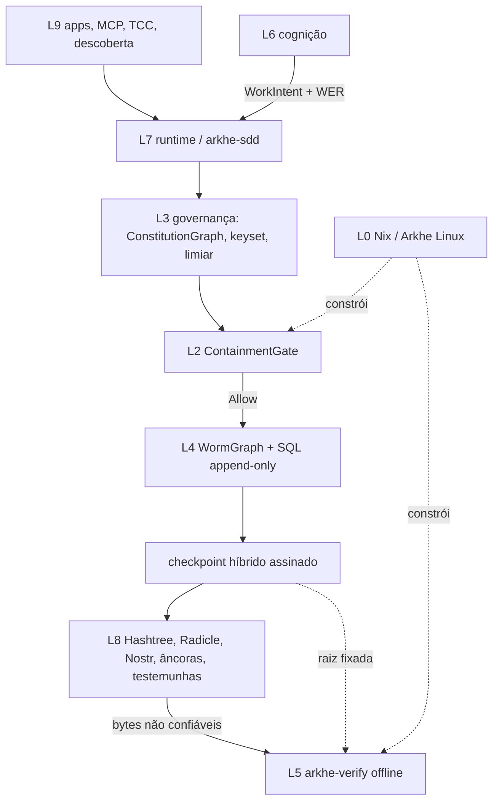

# Arkhe — arquitetura completa em camadas

**Status:** proposta consolidada, 2026-10-29. Não altera `arkhe-e02@1`, o perfil
`arkhe-mmr@1`, as migrações publicadas nem o candidato normativo B.0.2.
Consolida o monorepo atual, as propostas `arkhe-sdd`, `arkhe-tcc`, Arkhe Linux,
`arkhe-skills`, AKG-RFC-0002, descoberta por agentes e a avaliação
Hashtree + Radicle. Onde uma proposta anterior diverge do código, vale o código
e o [registro executável](../config/architecture.json).

Relação com os documentos existentes: [ARCHITECTURE.md](ARCHITECTURE.md)
descreve o workspace ativo; [P2P-ARCHITECTURE-REVIEW.md](P2P-ARCHITECTURE-REVIEW.md)
fixa as regras de aquisição verificável; este documento coloca tudo numa pilha
única e define a camada de descentralização que falta.

---

## 0. Princípios que valem para todas as camadas

1. **O kernel é invariante, a cognição é substituível, transição protegida exige
   evidência.** Nenhum modelo, agente ou adapter recebe autoridade de escrita.
2. **Três propriedades distintas, nunca confundidas:**
   - *integridade*: os bytes correspondem a um compromisso fixado;
   - *autoridade*: quem tem direito de declarar o estado canônico;
   - *disponibilidade*: alguém ainda serve os bytes.
   Hash prova a primeira, assinatura sob política prova a segunda, só
   replicação sob hipóteses explícitas melhora a terceira.
3. **Fail-closed:** ou há evidência, ou o sistema declara que não há
   (`EVIDENCE_DEGRADED`, `Incomplete`). Nenhum caminho "continua mesmo assim".
4. **Transporte não confiável por padrão.** Todo canal de rede (Radicle, Nostr,
   Blossom, HTTP, IPFS) entrega candidatos; a verificação local decide.
5. **Descentralizar é remover pontos únicos de confiança**, não remover todo
   servidor. A meta mensurável é *k-de-n* fontes independentes em cada dimensão.
6. **Honestidade τ:** cada componente declara `LEMMA` (demonstrado),
   `CONJECTURE` (coerente, não testado), `PENDING` (não existe) ou `REFUTED`.

---

## 1. Visão geral da pilha

```text
┌────────────────────────────────────────────────────────────────────────┐
│ L9  INTERFACES E DESCOBERTA                                            │
│     apps (Intra, preflight, ask), verify-mcp, TCC, A2A card,           │
│     ai-catalog.json, llms.txt, DNS-AID, MCP Registry                   │
├────────────────────────────────────────────────────────────────────────┤
│ L8  DISTRIBUIÇÃO E DESCENTRALIZAÇÃO                         (nova)     │
│     Hashtree/Blossom · Radicle · Nostr · Bao/iroh · espelhos Git       │
│     ponte de identidade · âncoras e testemunhas de checkpoint          │
├────────────────────────────────────────────────────────────────────────┤
│ L7  TRABALHO E ORQUESTRAÇÃO                                            │
│     work/*, orchestration/arkhe-runtime, preview admission/worker,     │
│     arkhe-sdd (parser → gate → recorder → anchor → audit → verify)     │
├────────────────────────────────────────────────────────────────────────┤
│ L6  COGNIÇÃO (sem autoridade)                                          │
│     cognition/* (perception, rag, metacognition, world-model,          │
│     learning, agent), providers (Ollama), emitem WorkIntent + WER      │
├────────────────────────────────────────────────────────────────────────┤
│ L5  VERIFICAÇÃO PURA                                                   │
│     arkhe-verify-core · CLI · WASM · golden vectors · arkhe-kya        │
├────────────────────────────────────────────────────────────────────────┤
│ L4  EVIDÊNCIA                                                          │
│     arkhe-wormgraph (MMR) · arkhe-memory · storage/sql append-only     │
│     OperationJournal · outbox · checkpoints híbridos                   │
├────────────────────────────────────────────────────────────────────────┤
│ L3  GOVERNANÇA                                                         │
│     arkhe-governance · ConstitutionGraph · trust-registry · keyset     │
│     delegados + limiar · arkhe-sdd-parser · AKG-RFC-0002               │
├────────────────────────────────────────────────────────────────────────┤
│ L2  KERNEL (TCB)                                                       │
│     arkhe-kernel · ContainmentGate · máquina de estados determinística │
├────────────────────────────────────────────────────────────────────────┤
│ L1  PRIMITIVAS CANÔNICAS                                               │
│     arkhe-core · AKG-CBOR-v1 · BLAKE3 · domínios AKG:* · Ed25519       │
│     (+ ML-DSA no perfil RBB) · WorkIntent/WER preimages                │
├────────────────────────────────────────────────────────────────────────┤
│ L0  BASE DE EXECUÇÃO E CADEIA DE SUPRIMENTO                            │
│     nixpkgs-arkhe (narHash reprodutível, derivações CA) · Arkhe Linux  │
│     (UKI, TPM 2.0, IMA) · Podman/Compose · Windows MSI                 │
└────────────────────────────────────────────────────────────────────────┘
        Transversais: τ/PassLaneAuditor · observabilidade · LGPD · supply chain
```

Regra de dependência: uma camada só depende das inferiores. L6 depende de
contratos de L1, nunca de L4 diretamente. L8 e L9 são adapters: um resultado
vindo delas nunca concede autorização em L2/L3.



---

## 2. Camadas em detalhe

Cada linha: responsabilidade, onde vive hoje, estado τ, e o que **não** faz.

### L0 — Base de execução e cadeia de suprimento

| Componente | Onde | τ | Notas |
|---|---|---|---|
| Pacotes Nix, overlay, overlay CA, módulos `arkhe-node`/`arkhe-audit` | `nixpkgs-arkhe/` | `LEMMA` | 24 checks em x86_64-linux; narHash idênticos entre clones para `arkhe-verify`, `arkhe-verify-wasm`, `arkhe-sdd-parser` |
| Comparação host × VM com toolchain 1.96.0 | — | `PENDING` | Registrada só para a versão anterior |
| Arkhe Linux (perfis node/audit/verify, UKI, TPM, IMA) | proposta | `CONJECTURE` | `arkhe-mmrd`, `arkhe-journald`, `arkhe-gate`, `arkhe-anchor`, `arkhe-prove` **não existem como crates** |
| Runtime local Podman/Compose | `ops/`, `scripts/live_runtime.py` | `LEMMA` | Desenvolvimento, não produção |
| Distribuição Windows (MSI/ZIP) | `packaging/windows`, `dist/` | `LEMMA` | Existência de MSI não implica prontidão |

Decisão: o perfil `arkhe-verify` deve ser construível **apenas** a partir de
uma derivação Nix cujo narHash é publicado no `ReleaseManifest` (§4.4). Isso
liga L0 a L8: quem baixa o verificador por qualquer canal consegue recompilar
e comparar.

### L1 — Primitivas canônicas

| Componente | Onde | τ |
|---|---|---|
| AKG-CBOR-v1, preimages WorkIntent/WER, 17 vetores Python/Rust | `kernel/arkhe-core` | `LEMMA` |
| Domínios `AKG:*` e separação de domínio | `arkhe-core`, `specs/akg` | `LEMMA` (registry PoC); B.0.2 `NOT FROZEN` |
| Assinatura híbrida Ed25519 + ML-DSA-44 | perfil Arkhe-RBB | `CONJECTURE` no monorepo; a PoC AKG é Ed25519-only (achado A3) |

Novos domínios necessários para L8 (a registrar no Domain Registry, não
inventar fora dele): `AKG:RELEASE:v1\0`, `AKG:IDBIND:v1\0`,
`AKG:WITNESS:COSIG:v1\0`, `AKG:LOCATOR:v1\0`.

### L2 — Kernel (TCB)

`kernel/arkhe-kernel` e o `ContainmentGate` são a única autoridade de
transição (`authorities.authorization`). Default deny, saída tipada
`Allow | Deny{reason} | Escalate{to}`. `LEMMA` para o fluxo
proposta → WER → política → gate → commit no runtime.

O que não faz: não executa efeitos externos, não fala com rede, não confia
em nenhuma camada superior. Os dados de L8 entram no gate apenas como
`VerifiedBlob` já produzido por L5.

### L3 — Governança

| Componente | Onde | τ |
|---|---|---|
| Resolução de política | `governance/arkhe-governance` | `LEMMA` |
| Registro de chaves públicas | `governance/trust-registry` | `LEMMA` (digest publicado) |
| `arkhe-sdd-parser` (EARS + Given/When/Then → ConstitutionGraph + WorkIntent) | `governance/arkhe-sdd-parser` | `LEMMA` para build reprodutível; cobertura EARS completa `CONJECTURE` |
| AKG-RFC-0002 v0.1.3 PoC-NORM-1 | `specs/akg` | W02-04 `CLOSED`; W02-09 `PASS_CANDIDATE` pendente A1 (`DomainPolicy` como prefixo constante) |
| Delegados com limiar para estado canônico do código | — | `PENDING` (§4.2) |

Ponto central para a descentralização: **a autoridade canônica do Arkhe é o
keyset + limiar declarado em L3, nunca a rede de distribuição.** Radicle,
Nostr e Hashtree têm as suas próprias identidades; elas só valem dentro do
Arkhe depois de vinculadas por um `IdentityBinding` (§4.3).

### L4 — Evidência

| Componente | Onde | τ |
|---|---|---|
| WormGraph / MMR `arkhe-mmr@1` | `evidence/arkhe-wormgraph`, perfil em `arkhe-verify-core::mmr::profile` | `LEMMA` |
| Memória | `evidence/arkhe-memory` | `LEMMA` (referência) |
| Persistência append-only, RLS | `storage/sql` (13 migrações com digests travados) | `LEMMA` |
| Outbox + leases + fencing do preview worker | `docs/PREVIEW-EXECUTION.md` | `LEMMA` local |
| Checkpoint ancorado (Rekor, Solana, RBB) | `apps/arkhe-intra` (Rekor), `integrations/solana-proof`, `integration/arkhe-rbb` | protótipos; produção `PENDING` |

### L5 — Verificação pura

`arkhe-verify-core` não depende de HTTP, filesystem, PostgreSQL ou relógio.
CLI, WASM e `verify-mcp` são adapters. `arkhe-kya` verifica registros de
integridade de agentes. `LEMMA` para os vetores READY; C2PA-001 continua
`CANDIDATE`.

Acréscimo para L8: `arkhe-verify release <manifest>` (§4.6), que encadeia
inclusão MMR + cossinaturas de testemunhas + compromissos de conteúdo, sem
rede obrigatória.

### L6 — Cognição

Seis módulos em `cognition/` mais `arkhe-agent`, providers em `integration/`
(Ollama). Produzem `WorkIntent` e `WorkerExecutionRecord`; não recebem chave
de assinatura. **Capacidade AGI não foi demonstrada** (`REFUTED` como
afirmação atual); a tese "Arkhe é a AGI" de propostas anteriores é design
fiction, não arquitetura.

Papel na descentralização: a cognição pode *analisar* patches vindos do
Radicle e emitir parecer tipado; o parecer é evidência, nunca aprovação.

### L7 — Trabalho e orquestração

| Componente | Onde | τ |
|---|---|---|
| `arkhe-runtime` (HTTP, transação WorkIntent+WER+envelope) | `orchestration/` | `LEMMA` |
| Preview admission / worker / cockpit | `docs/PREVIEW-*.md` | `LEMMA` local |
| `arkhe-sdd`: gate V1–V6 como **commit/merge floor** | proposta | parser existe; gate, recorder, anchor, auditor, verify `PENDING` |
| `PassLaneAuditor` com os quatro números | proposta | `PENDING` |

O `arkhe-sdd-gate` é o ponto onde L7 encontra L8: um patch só vira estado
canônico (Radicle canonical refs, root Hashtree publicado) depois de
`GateDecision::Allow` ancorado (§4.5, passo 3).

### L8 — Distribuição e descentralização (nova)

Detalhada na §3 e §4. Componentes:

| Componente | Onde | τ |
|---|---|---|
| Publicação pública Git via Hashtree/Blossom + anúncio Nostr | `docs/evidence/2026-10-23-e02-hashtree/` | `LEMMA` (leitor limpo: 155 objetos, 101 ficheiros, 109 testes) |
| `DualVerifier`, `BaoVerifier`, `BlossomTransport`, `NostrDiscovery` | `integration/arkhe-p2p` | `LEMMA` local (18 testes + doctest) |
| `HashtreeVerifier` (árvore, CHK, ficheiros fragmentados) + `htree-mirror` | `integration/arkhe-p2p` | `LEMMA` local e de rede: 108 ficheiros E02 iguais ao Git; mirror público sem chave do publicador (2026-10-29) |
| `ReleaseManifest` v1 (`AKG:RELEASE:v1`) | `kernel/arkhe-core/src/release.rs`, `specs/release/` | `LEMMA` para codificação: 23 vetores Python/Rust; assinaturas `PENDING` |
| Radicle como forge P2P | — | `PENDING`; bloqueado pelo advisory de 2026-09-23 (§3.2) |
| `IdentityBinding` (Arkhe ↔ Nostr/Radicle, revogação, envelope) | `evidence/arkhe-wormgraph/src/binding.rs` | `LEMMA` com chaves de TESTE; nenhuma chave real provisionada |
| Testemunhas | — | `PENDING` |

### L9 — Interfaces e descoberta

| Componente | Onde | τ |
|---|---|---|
| Intra, preflight, melodic-lab, ask, chladni | `apps/` | `LEMMA` (superfícies locais) |
| MCP de verificação (WASM) | `integrations/verify-mcp` | `LEMMA` |
| `integrations/mcp-server` | — | scaffold de health, **sem ferramentas** (a proposta de descoberta presume o contrário) |
| TCC v0.2 (E0/E1-SPC/E1-DEVICE/E1-EXT) | proposta `arkhe-tcc` | `CONJECTURE` |
| MCP Registry, A2A `agent-card.json`, `ai-catalog.json`, `llms.txt`, DNS-AID | proposta | `PENDING`; publicar no registro é ação externa e exige aprovação |

Descentralização da descoberta: além de DNS (que depende de registrar e
DNSSEC), publicar o mesmo cartão como evento Nostr assinado pela chave
vinculada e como ficheiro no root Hashtree. O agente que descobre por
qualquer canal verifica a assinatura contra o `IdentityBinding` ancorado.

---

## 3. Avaliação Hashtree + Radicle

### 3.1 Hashtree

O que é: sistema de ficheiros endereçado por conteúdo sobre Nostr. Árvore
Merkle SHA-256, CHK opcional, roots mutáveis publicadas por `npub`, blobs em
servidores Blossom; `git-remote-htree` dá remotes `htree://npub…/repo`.

| Propriedade | Avaliação | τ |
|---|---|---|
| Integridade de cada bloco contra root | forte; já usada e verificada na E02 | `LEMMA` |
| Leitura sem chave do publicador | demonstrada | `LEMMA` |
| Autoridade sobre a root mutável | a chave Nostr do publicador; **uma única chave secp256k1** — não há limiar | `LEMMA` (limitação) |
| Disponibilidade | depende dos servidores Blossom e relays; P2P direto não demonstrado | `LEMMA` (limitação) |
| Identificador | `HashtreeCid` (SHA-256, nós/ciphertext) ≠ `BlobDigest` (BLAKE3 dos bytes lógicos) — nunca comparar roots diretamente | regra já fixada |
| Maturidade | crates 0.2.x, protocolo HTS-01 em draft | `LEMMA` (risco) |

Veredito: **adotar como plano primário de distribuição de conteúdo**, porque
já está provado no Arkhe e porque a verificação não depende do servidor. Não
usar a root mutável `npub/…` como fonte de verdade: o Arkhe fixa a root
imutável (`nhash`) de cada release no `ReleaseManifest`, e a root mutável é
só um ponteiro de conveniência.

### 3.2 Radicle

O que é: forge P2P sobre Git. Repositório identificado por RID derivado de
um documento de identidade com delegados e limiar; refs assinadas; gossip e
seeding entre nós.

Advisory de [2026-09-23](https://radicle.dev/2026/09/23/disclosure-of-vulnerability-in-network-protocol):

- todas as versões publicadas transmitem tráfego de nó em texto claro e a
  autenticação de pares está quebrada (impersonação de Node ID);
- **integridade mantém-se**: refs assinadas detetam modificação em trânsito;
- repositórios privados devem deixar de ser servidos; Tor/I2P/VPN não
  resolvem a impersonação;
- a correção é substituir o transporte Noise por iroh, quebra de
  compatibilidade com partição temporária da rede; sem data de release.

| Propriedade | Avaliação | τ |
|---|---|---|
| Integridade de código público | refs assinadas; preservada mesmo com o advisory | `LEMMA` |
| Confidencialidade | quebrada em todas as versões atuais | `LEMMA` |
| Autoridade por delegados + limiar | modelo nativo útil: espelha o limiar do Arkhe | `LEMMA` (design Radicle); integração `PENDING` |
| "Hostile takeover" por fork popular | um fork tem outro RID; o risco é social (utilizadores seguirem o RID errado), não forja de refs. A proposta anterior exagerava a falha | `CONJECTURE` (corrige texto anterior) |
| Colaboração (patches, issues) P2P | diferencial real face ao Hashtree | `LEMMA` |
| Estabilidade do protocolo | mudança de transporte iminente e incompatível | `LEMMA` (risco) |

Veredito: **adotar Radicle como plano de colaboração para código público,
depois da versão sobre iroh**, e somente com RID fixado no keyset do Arkhe.
Até lá, no máximo um espelho público experimental. Nunca para material
privado, chaves, dados pessoais ou fixtures sensíveis.

### 3.3 A combinação

Os dois são complementares, não redundantes:

| Dimensão | Hashtree | Radicle | Quem decide no Arkhe |
|---|---|---|---|
| Conteúdo de release (bytes) | ✅ primário | ◻ (Git apenas) | L5 verificação |
| Histórico Git e patches | ✅ leitura | ✅ colaboração | L7 `arkhe-sdd-gate` |
| Identidade | Nostr secp256k1 | did:key Ed25519 (Node/Delegate) | L3 `IdentityBinding` |
| Limiar de aprovação | ✗ | ✅ delegados | L3 keyset (o do Radicle só espelha) |
| Disponibilidade | Blossom + relays | seeds | k-de-n seeds institucionais |
| Tempo / ordem | ✗ | ✗ | L4 checkpoint + L8 âncoras/testemunhas |

**"Total descentralização" com apenas Hashtree + Radicle: `REFUTED`.** Os dois
descentralizam integridade, distribuição e colaboração de código. Não
descentralizam:

1. **ordem e tempo** — sem log de checkpoints testemunhado por partes
   independentes, um operador pode mostrar vistas diferentes a leitores
   diferentes (*split view*);
2. **autoridade** — continua a ser o keyset do Arkhe; descentralizá-la é
   limiar k-de-n entre detentores independentes, não protocolo de rede;
3. **descoberta por agentes** — DNS e registros MCP são centralizados;
4. **build** — sem reprodutibilidade independente, o binário confia em quem
   compilou;
5. **cognição** — providers de modelo continuam externos.

A arquitetura abaixo fecha 1, 2, 4 e parte de 3. O item 5 fica declarado.

---

## 4. Desenho da camada L8

### 4.1 Planos

```text
              ┌──────────── autoridade (L3) ─────────────┐
              │ keyset Arkhe · limiar k-de-n · bindings  │
              └───────────────┬──────────────────────────┘
                              │ assina
┌──────────────┐   ┌──────────▼─────────┐   ┌──────────────────────────┐
│ colaboração  │──▶│ ReleaseManifest    │──▶│ evidência (L4)           │
│ Radicle      │   │ AKG:RELEASE:v1     │   │ folha MMR → checkpoint   │
│ (patches)    │   └──────────┬─────────┘   └───────────┬──────────────┘
└──────────────┘              │                         │ cossinam
                              │ aponta                  ▼
┌─────────────────────────────▼──────────┐   ┌──────────────────────────┐
│ conteúdo                               │   │ testemunhas + âncoras    │
│ Hashtree nhash · Blossom · Bao/iroh    │   │ witnesses independentes  │
│ espelhos Git (GitHub, Radicle, htree)  │   │ Rekor · Solana · RBB/TSA │
└─────────────────────────────┬──────────┘   └───────────┬──────────────┘
                              │ bytes não confiáveis      │ raiz fixada
                              └──────────▶ arkhe-verify ◀─┘  (L5, offline)
```

### 4.2 Autoridade com limiar

- `governance/trust-registry` passa a conter um **keyset de release**:
  `n` chaves de pessoas/instituições distintas, limiar `k`, validade,
  algoritmo e regra de rotação. A rotação é ela própria um `ReleaseManifest`
  assinado por `k` chaves do keyset anterior.
- O documento de identidade Radicle do repositório usa os mesmos `n`
  delegados e o mesmo `k`. Divergência entre os dois → o verificador rejeita
  (o do Arkhe prevalece; o do Radicle é só espelho operacional).
- Hashtree não tem limiar: a chave Nostr que publica a root mutável é uma
  **chave operacional** sem autoridade. A autoridade está na assinatura k-de-n
  sobre o manifesto que contém o `nhash` imutável.

### 4.3 Ponte de identidade (`IdentityBinding`)

Implementado (D2) conforme [AKG-IDENTITY-0003](../evidence/arkhe-wormgraph/docs/AKG-IDENTITY-0003.md).
A versão implementada difere do rascunho abaixo em três pontos: a prova Nostr é
um evento NIP-01 kind 30078 assinado pela chave externa (qualquer signer Nostr
o produz); a revogação é um objeto próprio, assinado pela chave Arkhe do binding
ou por um membro do roster; e a chave Arkhe tem de estar no roster em
`valid_from` e no instante avaliado. Rascunho original:

Registro CBOR canônico, domínio `AKG:IDBIND:v1\0`:

```text
IdentityBinding {
  arkhe_key:     IdentityRef            ; chave do trust-registry
  external:      { kind: "radicle-did" | "nostr-npub" | "libp2p-peer" | "iroh-node",
                   id: bytes }
  role:          "delegate" | "publisher" | "seed" | "witness"
  valid_from, valid_until
  sig_arkhe:     assinatura da chave Arkhe sobre o preimage
  sig_external:  assinatura da chave externa sobre o mesmo preimage   ; posse bidirecional
}
```

- Namespaces preservados: um npub (secp256k1/BIP-340) nunca é tratado como
  did:key Ed25519, mesmo que o mesmo humano controle ambos.
- Cada binding é folha do WormGraph; revogação é outra folha com
  `valid_until` antecipado. Sem binding ancorado, a identidade externa é
  apenas `ProviderIdentity` — metadado, não autoridade.

### 4.4 `ReleaseManifest`

Implementado (D0) em `kernel/arkhe-core/src/release.rs`; especificação em
[specs/release](../specs/release/README.md). Domínio `AKG:RELEASE:v1\0`,
AKG-CBOR-v1 com tipos explícitos e decodificador estrito:

```text
ReleaseManifest {
  version, release_id, prev_release_digest       ; encadeamento anti-rollback
  git:       { commit_oid, tag | null }
  radicle:   { rid, canonical_refs_digest } | null
  hashtree:  { root_hash, decrypt_key | null } | null   ; root imutável, não npub/…
  artifacts: [ { path, size, blake3, sha256 } ]  ; ordenados por path
  sdd:       { gate_decision_digest, constitution_digest } | null   ; L7
  build:     { system, flake_lock_digest } | null                   ; L0
  policy_digest
}
envelope separado (PENDING): k-de-n assinaturas do keyset sobre object_digest
```

Diferenças face ao rascunho anterior: as assinaturas saíram do objeto (o digest
assinado não pode conter as assinaturas), `tree_oid`, `nar_hash` e `bao_root`
ficaram para uma v2 quando houver consumidor, e `null` nunca equivale a ausência.

O manifesto é o único objeto que liga todos os identificadores. Nenhum
verificador compara `nhash_root` com `blake3`; verifica cada um no seu
próprio protocolo e confere que ambos estão no mesmo manifesto assinado.

### 4.5 Fluxo de release

```text
1. patch       contribuinte (humano ou agente) propõe no Radicle ou PR espelho
2. análise     L6 emite parecer tipado (WER) — evidência, não aprovação
3. gate        L7 arkhe-sdd-gate verifica V1–V4; ContainmentGate decide
4. limiar      k delegados assinam canonical refs (Radicle) e o manifesto (Arkhe)
5. build       Nix constrói; narHash comparado com ≥ 2 builders independentes
6. conteúdo    git push htree:// + blobs no Blossom (+ Bao opcional); obter nhash
7. evidência   ReleaseManifest → folha MMR → checkpoint híbrido assinado
8. testemunho  ≥ w testemunhas independentes cossinam o checkpoint (anti split view)
9. âncora      raiz em Rekor + uma cadeia pública (Solana ou RBB) + TSA opcional
10. anúncio    evento Nostr (NIP-94/NIP-34) + Radicle + ai-catalog/llms.txt
```

Passos 1–4 falham fechado: sem `Allow` ancorado não há canonical refs.
Passos 6–10 podem falhar parcialmente; a release fica `DISTRIBUTION_DEGRADED`
declarado, nunca silenciosamente "publicada".

### 4.6 Verificação pelo consumidor

```text
entrada fixada: keyset de release (ou digest do trust-registry) + limiar de testemunhas
1. obter checkpoint de ≥ 2 fontes distintas (Nostr, Radicle, Rekor, cadeia)
2. verificar assinatura híbrida + ≥ w cossinaturas; vistas divergentes → rejeitar
3. verificar inclusão MMR do ReleaseManifest (arkhe-verify, offline)
4. verificar k-de-n assinaturas do manifesto contra o keyset
5. obter bytes de QUALQUER transporte (htree, Blossom, Radicle, GitHub, pen drive)
6. verificar no protocolo nativo (SHA-256/CHK, refs assinadas) e depois BLAKE3
7. opcional: rebuild Nix e comparar narHash
saída: VerifiedRelease (campos privados) | Rejected{motivo} | Incomplete{diagnóstico}
```

Integridade não depende de nenhum transporte. Disponibilidade depende de pelo
menos um transporte responder — e isso é declarado como observação.

### 4.7 Testemunhas de checkpoint

O MMR prova inclusão, mas não impede o operador de manter dois logs. A
mitigação padrão é cossinatura por testemunhas independentes que só assinam
checkpoints que estendem o último que viram (modelo de *witness* dos logs de
transparência; avaliar o formato C2SP `tlog-checkpoint`/`tlog-witness`
antes de inventar um próprio). Cada testemunha é um `IdentityBinding` com
`role: "witness"`. Começar com 3 testemunhas operadas por partes distintas
(ex.: Interlegis, uma universidade, um operador independente) e limiar 2.

### 4.8 Disponibilidade

- Seeds institucionais para Radicle e servidores Blossom próprios/parceiros:
  meta ≥ 3 operadores distintos, sem partilhar ASN.
- Espelho GitHub mantido como **mais um transporte não confiável**, não como
  origem.
- Bao/iroh só para artefactos grandes ou retomada por ranges, depois de
  medida a necessidade (decisão já registrada na revisão P2P).
- DHT própria, PoW, erasure coding: adiados. Não há evidência de necessidade.

### 4.9 Novos componentes propostos

| Componente | Camada | Onde | Depende de |
|---|---|---|---|
| `HashtreeVerifier` (decodifica árvore, CHK, reconstrói bytes lógicos) | L8/L5 | `integration/arkhe-p2p/src/hashtree.rs` | **feito (D1)**; HTS-01 ainda draft, perfil fixado em `hashtree-core` 0.2.91 |
| `ReleaseManifest` (tipos, preimage, decodificador estrito) | L1/L3 | `kernel/arkhe-core/src/release.rs` | **feito (D0)**; envelope de assinaturas pendente |
| `IdentityBinding`, verificação bidirecional e revogação | L3/L4 | `evidence/arkhe-wormgraph/src/binding.rs` (junto do roster) | **feito (D2)** com chaves de teste; chave real depende do trust-registry |
| `arkhe-witness` (cossinatura de checkpoint) | L4/L8 | `evidence/` | formato de checkpoint escolhido |
| `arkhe-verify release` | L5 | `verification/crates/arkhe-verify-cli` | os três acima |
| `RadicleTransport` (leitura de refs canônicas) | L8 | `integration/arkhe-p2p` | Radicle sobre iroh |

Os três últimos não existem.

---

## 5. Roteiro com critérios de avanço

| Fase | Entregável | Critério de aceite | Bloqueio |
|---|---|---|---|
| **D0** ✅ | `ReleaseManifest` + domínio registrado + vetores dourados | CBOR determinístico Rust/Python idêntico; alteração de 1 byte rejeitada | registry próprio em `specs/release`, sem depender de A1 |
| **D1** ✅ | `HashtreeVerifier` sobre a publicação E02 existente | clone limpo verifica `nhash` e BLAKE3 sem chave do publicador; truncamento/corrupção rejeitados | nenhum |

D0 e D1 concluídos em 2026-10-29: 23 vetores `ReleaseManifest` idênticos entre
Python e Rust, todas as 2 × 725 alterações de byte do manifesto E02
rejeitadas; 108 ficheiros E02 reconstruídos do Hashtree iguais ao Git, mirror
público em diretório novo sem chave do publicador e rejeição de cada bloco
danificado. Reprodução em [specs/release](../specs/release/README.md) e
[integration/arkhe-p2p](../integration/arkhe-p2p/README.md).
| **D2** ✅ | `IdentityBinding` npub ↔ chave Arkhe ancorado | binding sem assinatura externa rejeitado; revogação respeitada | binding real: chave do roster provisionada e assinatura do titular do npub |
| **D3** | `arkhe-verify release` offline ponta a ponta | release verificada a partir de pen drive, sem rede | D0–D2 |
| **D4** | 3 testemunhas, limiar 2 | split view simulado rejeitado | parceiros externos |
| **D5** | Radicle (versão iroh) como plano de colaboração público | RID no keyset; delegados = keyset; divergência rejeitada | release Radicle sobre iroh |
| **D6** | 3 operadores de disponibilidade distintos | recuperação com 2 de 3 offline | parceiros |
| **D7** | descoberta: verify-mcp no MCP Registry, A2A card, ai-catalog, cartão em Nostr/Hashtree | agente externo descobre e verifica assinatura do cartão | aprovação explícita para publicar |

Go/no-go para Radicle (D5): adotar só se (a) a versão iroh estiver publicada
e com advisory fechado, (b) o RID e delegados puderem ser verificados
offline pelo `arkhe-verify`, e (c) existir pelo menos um seed institucional.
Sem isso, Hashtree + espelho Git cobrem a distribuição.

---

## 6. Modelo de ameaças da camada L8

| Ameaça | Cobertura |
|---|---|
| Servidor/peer entrega bytes alterados | detectado (SHA-256/CHK + BLAKE3 + refs assinadas) |
| Peer alega o próprio digest | irrelevante: digest esperado vem do manifesto assinado |
| Rollback para release antiga | detectado (`prev_release_digest` + checkpoint monotônico) |
| Split view pelo operador do log | mitigado por testemunhas (D4); sem D4, **não coberto** |
| Roubo de 1 chave de delegado | mitigado pelo limiar k > 1 |
| Roubo da chave Nostr publicadora | só altera o ponteiro mutável; releases fixadas continuam válidas |
| Fork Radicle com outro RID | rejeitado: RID não está no keyset |
| Impersonação/escuta no Radicle atual | aceito para código público; **proibido** para material privado |
| Todos os transportes indisponíveis | não resolvido; declarado `Incomplete` |
| Eclipse/Sybil na descoberta | reduzido por múltiplos canais independentes; não demonstrado |
| Compromisso do build | mitigado por rebuild Nix independente (narHash) |
| Compromisso de hardware/firmware | fora do escopo |

---

## 7. Nota de honestidade (τ)

| Afirmação | τ | Nota |
|---|---|---|
| As 10 camadas refletem a estrutura e as autoridades do monorepo | `LEMMA` | `config/architecture.json`, `docs/ARCHITECTURE.md` |
| Hashtree já distribui um repositório Arkhe verificável por leitor limpo | `LEMMA` | evidência E02 de 2026-10-23 |
| Radicle atual é inseguro para conteúdo privado | `LEMMA` | advisory oficial de 2026-09-23 |
| Radicle atual preserva a integridade de código público | `LEMMA` | mesmo advisory: refs assinadas |
| "Hostile takeover" é falha do protocolo Radicle | `REFUTED` como formulado | fork tem RID distinto; risco é social e mitigado por RID fixado |
| Hashtree + Radicle bastam para descentralização total | `REFUTED` | faltam ordem/tempo, limiar de autoridade, build e descoberta |
| `ReleaseManifest` tem uma única forma canônica, idêntica entre Python e Rust | `LEMMA` | D0: 23 vetores, decodificador estrito, toda alteração de 1 byte rejeitada |
| Um leitor sem chave do publicador verifica a publicação E02 bloco a bloco contra o Git | `LEMMA` | D1: fixture offline e mirror público de 2026-10-29 |
| Uma identidade Nostr/Radicle só ganha papel no Arkhe com as duas assinaturas e uma chave do roster | `LEMMA` | D2: 9 testes, referência Python e verificação cruzada pelo crate `nostr`; só chaves de teste |
| Com testemunhas, limiar, Nix e k-de-n transportes não resta ponto único de confiança na distribuição | `CONJECTURE` | desenho coerente; só D0–D2 implementados |
| A cognição pode automatizar a revisão de baixo risco | `CONJECTURE` | parecer é evidência; aprovação continua no limiar |
| Arkhe é uma AGI | `REFUTED` como estado atual | o próprio repositório declara que não foi demonstrada |
| `integrations/mcp-server` expõe ferramentas de verificação | `REFUTED` | é scaffold; a ferramenta funcional é `verify-mcp` |

---

## Fórmula final

O Arkhe é uma pilha de dez camadas em que só L2/L3 têm autoridade, L4/L5
produzem e verificam evidência, e tudo acima é adapter substituível. A
descentralização entra como L8 e segue a mesma regra: **transportes
entregam bytes, o manifesto assinado por limiar diz quais bytes valem, e o
checkpoint testemunhado diz quando.** Hashtree é adotável já, porque está
provado no próprio repositório. Radicle é o plano certo para colaboração
pública, mas só depois da migração para iroh e com o RID preso ao keyset.
Juntos descentralizam integridade e distribuição de código; a
descentralização "total" exige ainda testemunhas independentes, limiar k-de-n
entre instituições distintas e builds reprodutíveis verificados por
terceiros. D0, D1 e D2 (o `ReleaseManifest`, o `HashtreeVerifier` sobre a
publicação E02 e o `IdentityBinding`) estão feitos; o próximo passo é D3,
`arkhe-verify release` offline ponta a ponta.
