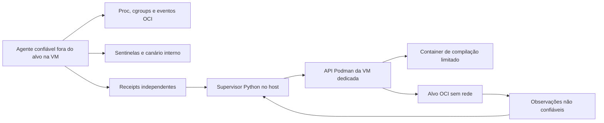

# Executor de runtime e oráculos externos

Estado: **PILOT_EXECUTED_FULL_SUITE_PENDING**. O runner dos seis observadores
foi implementado e executado em Podman rootless/WSL2. Contrato de máquina:
`config/runtime-executor-contract.json`. A suíte completa de 22 vetores continua
pendente. Observações sintéticas não são tratadas como ensaio real.

## Primeiro ensaio e critério de conclusão

O alvo inicial é Podman rootless/OCI, compatível com o perfil encontrado no
Arkhe. Não substituir o runtime por gVisor/runwasi/WASM na descrição dos resultados.
Uma variante nesses runtimes exigirá perfil, ferramentas, probes e evidências
próprios; esta sonda Rust usa std e não é um módulo WebAssembly no_std.

Primeiro ensaio: identity, cgroup-enforcement, mount-inventory, seccomp-inventory,
subprocess-control e input-read-control. São seis observadores já presentes na
fonte. Os outros 16 vetores não devem ser executados como se estivessem prontos.

| Campo | Significado |
| --- | --- |
| trial.execution_state=COMPLETE | Os seis alvos terminaram, seus artefatos e limpeza foram registrados |
| trial.verdict | Resultado limitado às propriedades realmente verificadas; pode ser FAIL ou ERROR mesmo com execução concluída |
| suite.status=INCOMPLETE | Há vetores/oráculos obrigatórios pendentes entre os 22 |
| runtime_verified=false | Obrigatório no primeiro ensaio, inclusive se os controles disponíveis passarem |

O inventário de seccomp pode concluir sua coleta sem verificar um filtro. Sem
perfil efetivo fixado e oráculo correspondente, esse requisito continua
UNSUPPORTED/UNASSESSED. Não trocar o catálogo para remover lacunas e obter PASS.
Um futuro PASS global exigirá todos os requisitos do perfil declarado, controles
pareados, identidades estáveis e comprovação de limpeza. COMPLETE nunca equivale
a PASS nem certifica ausência de todos os escapes possíveis.

## Fronteiras e topologia

Em Windows, o host que possui /proc, namespaces e cgroups é a VM Linux do
Podman, não o processo Python no Windows. O observador precisa operar nessa VM
fora dos namespaces/cgroup do alvo. Podman inspect remoto sozinho não cobre
todas as propriedades. Sem agente/telemetria independente disponíveis: ERROR ou
UNSUPPORTED, sem executar stress nem relaxar permissões.

O agente pode ser um processo VM-side pré-instalado com interface fixa e
permissões de leitura restritas aos recursos da sessão. Não expor shell genérico,
não fornecer seu socket ao alvo e não iniciar um container privilegiado para
contornar a falta de telemetria. Seus arquivos executáveis/configuração têm
hashes registrados e não são graváveis pelo alvo. Ele não requer acesso a
credenciais de aplicação ou tokens OIDC.

## Coordenação e lease

`apps/arkhe-intra/lib/lab-lock.mjs` implementa um token em memória de um processo
Node. Não fornece exclusão entre Python, outra instância do Intra e aplicativo
instalado. O executor NÃO DEVE tratar esse lock como lease global.

Preferência inicial: conexão/VM dedicada descartável para contenção, diferente
da VM usada pelo aplicativo. Alternativa futura: lease entre processos,
adquirido atomicamente, com run_id, proprietário, identidade de boot, heartbeat
e estado de limpeza. As duas partes precisam participar do protocolo. Arquivo
antigo ou PID inexistente não permite tomada automática do lease; exigir
reconciliação dos IDs e cgroups registrados. Falha de limpeza bloqueia outro
ensaio no mesmo ambiente.

Não parar aplicativo, reiniciar VM compartilhada ou delegar cgroups como root
para fazer o ensaio passar. A delegação necessária é pré-condição operacional.
O preparador existente que altera a VM não deve ser chamado implicitamente.

## Máquina de estados do executor

1. NEW → LEASED: reservar ambiente exclusivo e pasta nova de evidências.
2. PREFLIGHT: verificar sessão, fontes, imagem local por sha256, rootless,
   controlador cgroup v2, UID mapping, capacidade do observador e memória livre.
3. STAGED: criar somente fixtures da sessão na VM. Registrar caminhos reais,
   tipos/inodes e hashes. Confirmar que o sentinela externo não entra nos mounts.
4. BUILT: compilar a fonte imutável dentro da imagem, sem rede/pull. Copiar apenas
   binário conhecido e artefatos limitados para staging próprio. Hash do binário
   deve ser medido pelo supervisor e conferido no staging de execução.
5. CREATED: obter argumentos do mesmo builder usado por sandboxArguments.
   Criar alvo sem --rm; registrar ID exato, política efetiva, mounts e namespaces.
6. OBSERVING: agente externo confirma readiness e amostra eventos/recursos.
7. RUNNING: iniciar um único vetor, com nonce e fixture próprios, deadline e
   leitores de saída limitados. Não usar shell para interpolar dados da sonda.
8. SNAPSHOTTED: capturar observação, exit/sinal, eventos e estado final enquanto
   a informação ainda existe. Não remover o container antes da coleta.
9. CLEANED: remover somente IDs registrados; confirmar ausência e sentinelas.
10. ASSESSED: cruzar receipts e emitir decisão limitada ao requisito ensaiado.

Qualquer etapa pode entrar em ERROR → CLEANUP_PENDING → CLEANED/QUARANTINED.
Perda da conexão, crash ou timeout do cliente do engine não comprova que o alvo
parou. O watchdog e a reconciliação devem usar o ID exato na VM. Sem confirmação,
registrar QUARANTINED, não iniciar novos alvos e não reiniciar a VM automaticamente.

O builder agora é uma função pura em sandbox-policy.mjs, compartilhada por
development.mjs e pelo adaptador do runner, sem importar bancos/credenciais. Comparar argumentos
da execução com o digest da política; não manter cópia independente das flags.

## Oráculos independentes

### Ciclo de vida e identidade

Receipts do engine e do agente vinculam container ID, PID visto na VM, identidade
de boot, namespaces, uid_map e política. UID 10001 dentro do alvo não precisa
ser UID 10001 no host rootless: validar o mapeamento, não comparar números crus.
Correlacionar readiness, início, término, exit/sinal e confirmação de remoção.
PID sozinho não é identidade durável; incluir tempo de início e boot.

### Arquivos

Criar diretório sentinela próprio na VM, fora dos mounts. Não usar D:\\arkhe,
arquivos pessoais ou caminhos de segredos como canário. O caminho VM-native deve
ser explícito, não presumido a partir de um caminho Windows.

Antes/depois: registrar tipo do objeto sem seguir symlinks, inode, hash do
conteúdo, entradas do diretório e permissões relevantes. O input RO também tem
hash conferido antes/depois. Um hash igual não prova ausência de leitura;
para o teste de confidencialidade, registrar a resposta da tentativa e corroborar
com namespaces/mounts e ausência de caminhos alternativos expostos. Não alegar
confidencialidade geral a partir de ausência de escrita.

Aceitação de escrita negada: tentativa executada, erro coerente, fixture íntegra
e nenhuma entrada inesperada. Timeout ou falha de inicialização não contam como
negação. Não seguir symlinks ao coletar fixtures modificadas pelo alvo.

### Rede

Canário TCP/UDP/DNS em rede interna de fixtures, sem Internet ou portas publicadas.
O alvo permanece network=none. Cliente positivo é separado, com acesso somente
à rede interna; sua diferença de perfil deve constar no receipt.

Protocolo: readiness do listener → nonce positivo antes → janela do alvo → nonce
positivo depois → fechamento e receipt assinado apenas se houver infraestrutura
de assinatura real. Readiness contínua e supervisão do processo são obrigatórias.
Falha em qualquer controle invalida o resultado negativo. O alvo utiliza nonce
único e no máximo as tentativas/mensagens do catálogo; DNS usa porta interna
não privilegiada, não resolvedor público.

Recebimento do nonce do alvo implica FAIL. Não recebimento, com controles
funcionais e inventário de namespace/rotas compatível, sustenta somente a
propriedade ensaiada. Não declara captura de todo tráfego ou bloqueio universal
de egress. Socket criado, loopback local e /etc/hosts funcionando são permitidos.
Não derivar PASS apenas de connect/getaddrinfo falhando ou sendto retornando erro.

### Cgroups e watchdog

Agente confiável fora do cgroup alvo amostra a cada 100 ms, com relógio monotônico
e registro de perdas. Observar limites antes de iniciar carga e eventos durante
a execução; estatísticas podem desaparecer quando o cgroup é removido. Se não
houver evidência final preservada, o requisito é ERROR, não uma inferência a
partir do último exit code.

| Recurso | Evidência exigida no perfil reduzido |
| --- | --- |
| memória | memory.max=128 MiB, swap total limitado, amostras/eventos de OOM e estado OOMKilled do engine; distinguir SIGKILL do watchdog |
| CPU | cpu.max de 0,5 CPU, cpu.stat antes/depois, throttling observado e carga positiva; scheduler lento sozinho não prova quota |
| PIDs | pids.max=16, pids.current, pids.events:max e falha EAGAIN; até 24 tentativas sem forking recursivo |

Filhos do teste PID devem permanecer vivos por uma janela curta para exercitar
o limite, e ser coletados depois. Filhos que terminem antes do próximo spawn
podem não atingir o limite; nesse caso, não declarar enforcement verificado.

Primeiro ensaio apenas observa os limites de produção; não faz stress. A fase
posterior reduz os limites explicitamente e impõe os tetos do catálogo: 192 MiB
de tentativa de alocação, duas threads/3 s e 24 spawns. Não extrapolar esses
resultados para desempenho ou estabilidade da configuração de produção.

Watchdog externo limita cada probe, saída e duração global. Morte pelo watchdog
é ERROR; OOM e bloqueio de PID só contam quando corroborados pelo oráculo.
Nenhuma rotina de supervisão pode depender de thread dentro do alvo continuar viva.

## Deadlines e falhas

Orçamento global de 180 s, incluindo limpeza; reservar 15 s para ela. Pré-voo
até 20 s, compilação até 60 s. Cada alvo tem início até 10 s e probe até 3 s no
primeiro ensaio; seis alvos sequenciais. Se o tempo restante não cobrir a etapa
mais a reserva de limpeza, não iniciá-la. Saída de probe até 64 KiB; log de build
até 1 MiB, com truncamento classificado como ERROR.

Não repetir automaticamente carga de stress ou aumentar memória, PIDs, CPU,
privilégios e timeouts para obter PASS. Containers auxiliares também recebem
limites e IDs próprios. Falta de recurso do ambiente é ERROR/UNSUPPORTED.

## Receipts e decisão

Receipts separados: probe (não confiável), engine, agente/oráculo e cleanup.
Vincular run_id, vector_id, nonce, container ID, request hash, binário, imagem,
política efetiva, agente/oráculo, boot da VM e intervalos monotônicos. Registrar
proveniência de cada campo e hashes dos logs limitados. Nunca aceitar uma decisão
assinada pelo próprio alvo como decisão do supervisor.

Invariantes do avaliador futuro:

- Requisição e artefatos devem coincidir com o plano congelado para a sessão.
- Todos os oráculos obrigatórios devem cobrir a janela do vetor correspondente.
- Receipts de outras sessões, IDs, imagens ou políticas são rejeitados.
- JSON ambíguo, duplicatas, campos inesperados, output excessivo ou nonce inválido
  implicam ERROR. Fixtures alteradas ou efeito proibido observado implicam FAIL.
- Limpeza deve estar comprovada antes de uma decisão positiva.
- Ausência de observação, timeout, unsupported e unassessed nunca são PASS.
- SHA-256 vincula bytes, não autentica sozinho o supervisor. Assinatura OIDC real,
  quando disponível, é etapa posterior em job separado e não certifica segurança.

## Plano de implementação e validação

Ordem: adapter puro/lease → agente VM-side e receipts de lifecycle → compilação
isolada e seis observadores → oráculo de arquivos → canário de rede → supervisão
de recursos → política seccomp fixada/vetores por arquitetura → gate de CI.

Testes exigidos antes de permitir execução: conexão que cai, engine travado,
saída infinita, protocolo forjado, troca de nonce/container ID, heartbeat ausente,
canário indisponível, sentinela alterado, evento cgroup faltando, lease concorrente,
cleanup parcial e crash entre coleta e remoção. Usar doubles para esses testes,
identificados como sintéticos; eles não provam contenção real.

O runner parcial está em scripts/run_containment_trial.py; o observador VM-side
está em scripts/containment_vm_observer.py. Usa lease por criação atômica de
diretório no ambiente dedicado e não toma automaticamente leases antigos.
O PID recebido do engine é correlacionado pela cadeia NSpid e cgroup antes de
qualquer leitura: o namespace do serviço SSH pode diferir do observado por WSL.
Os ensaios posteriores de arquivos, rede e recursos estão documentados abaixo.
A política seccomp efetiva, FFI/mount e a decisão completa permanecem pendentes.
Resultado e limitações do ensaio real: [RUNTIME-TRIAL.md](RUNTIME-TRIAL.md).

Evolução posterior: [FILESYSTEM-CONTAINMENT.md](FILESYSTEM-CONTAINMENT.md), com
10 checks aprovados no perfil de arquivos, sem aprovação global de runtime.

Ensaio posterior de rede: [NETWORK-CONTAINMENT.md](NETWORK-CONTAINMENT.md),
com quatro vetores e seis controles positivos, sem aprovação global de runtime.

Atualização de recursos: [RESOURCE-CONTAINMENT.md](RESOURCE-CONTAINMENT.md).
Três vetores aprovados em perfil reduzido Podman rootless; suíte global ainda
INCOMPLETE e runtime_verified=false. Evidências: `docs/evidence/2026-10-19T044610Z-resource-trial/results.json`.

Atualização de syscalls (2026-10-19): [SYSCALL-CONTAINMENT.md](SYSCALL-CONTAINMENT.md).
Controles de subprocesso/FFI e negação de mount ensaiados; teste seletivo de
getppid aprovado em perfil seccomp explícito distinto. Não há aprovação da
tabela completa nem transferência para o perfil implícito. Suíte INCOMPLETE;
runtime_verified=false.

Contrato proposto da corrida unificada: [UNIFIED-CONTAINMENT-CONTRACT.md](UNIFIED-CONTAINMENT-CONTRACT.md).
Estado DRAFT, não selado e não executado. Candidato único de 128 MiB;
nenhuma aprovação automática do perfil de produção de 1536 MiB.
