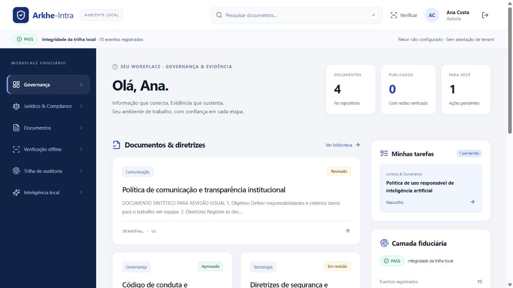

# Revisão das telas — Arkhe-Intra

Atualização de interface de 18/10/2026, aplicada ao perfil local do Arkhe-Intra.

## Telas e componentes

- Login: composição visual, campos, controle de visibilidade da senha e instruções de primeiro acesso.
- Navegação: barra lateral, menu recolhível em largura reduzida, página ativa e tratamento de erro ao sair.
- Governança: métricas, cartões, tarefas e carregamento sem simular dados inexistentes.
- Biblioteca e jurídico: busca, limpeza de filtros, seleção de estado, ordenação e estados vazios com ações úteis.
- Editor: contador de caracteres, confirmação do escopo de salvar e controles desabilitados durante a operação.
- Documento e assinatura: leitura do conteúdo, barra de ações e progresso das três assinaturas.
- Recibo: contexto de publicação e indicação explícita quando o documento não tem recibo.
- Laudo: hierarquia de resultados, data legível, tipagem do retorno e estilos de impressão A4.
- Auditoria: indicadores reais, busca, ordem cronológica alternável e explicação do escopo.
- Assistente: sugestões editáveis, contador, foco no campo, limpeza da conversa e preservação da pergunta após erro.
- Verificação: orientação em etapas e verificador independente com formulário, critérios, detalhes recolhíveis e exportação.
- Estados gerais: carregamento, erro, página não encontrada, foco visível e respeito à preferência por movimento reduzido.

O tema usa apenas CSS e fontes locais. A revisão não adiciona dependências de UI,
fontes remotas, dados demonstrativos à instalação ou novas autoridades de assinatura.

## Validação

- Build Next de produção standalone: PASS.
- TypeScript: PASS.
- Testes funcionais: 8 PASS, 0 falhas e 0 ignorados.
- Arquitetura: PASS, 23 crates Rust, 6 pacotes Node, 13 migrações.
- Navegador: login, painel, biblioteca, jurídico, editor, documento, recibo,
  laudo, auditoria, assistente, verificação, verificador independente e página 404.
- Busca sem resultados e limpeza de filtros: conferidas no navegador.
- Filtro de aprovados: conferido com exatamente um documento sintético aprovado.
- Criação pelo editor: contador atualizado, botão habilitado e documento salvo.
- Menu em painel estreito: abertura, navegação e fechamento conferidos.
- Sugestão do assistente: preencheu o campo, atualizou o contador e habilitou o envio.
- Busca e ordenação da auditoria: conferidas.
- Verificador independente: pacote sintético e confiança selecionados via interface;
  conteúdo, transições e assinaturas PASS; ancoragem e veredito completo INCONCLUSIVE.
- Preparação do cache offline: confirmação exibida. Não foi simulada perda de rede nesta rodada.

As contas e documentos usados na revisão são sintéticos, em diretório temporário
separado. Não houve publicação Rekor nem inferência Ollama nesta revisão visual.
As proteções desses fluxos continuam cobertas pelos testes funcionais.

## Prévia

As capturas adicionais estão em `docs/evidence/local/2026-10-18/ui-refresh`.
A distribuição anterior foi preservada; a atualização é empacotada separadamente
com o nome `Arkhe-0.1.0-ui-refresh-windows-x64`.

## Distribuição atualizada

- ZIP portátil: `dist/Arkhe-0.1.0-ui-refresh-windows-x64.zip` (118.729.693 bytes).
- MSI por usuário: `dist/Arkhe-0.1.0-ui-refresh-windows-x64.msi` (97.079.506 bytes).
- Launcher: `dist/Arkhe-0.1.0-ui-refresh-windows-x64/Arkhe.exe`.
- CLI: `dist/Arkhe-0.1.0-ui-refresh-windows-x64/arkhe-cli.exe`.

O ZIP extraído passou pela conferência SHA256 dos 2.251 arquivos, ausência de
contas/chaves de desenvolvimento e formatos PE gráfico/console. O teste real
da distribuição passou nos sete grupos de operação, fluxo HTTP de três
assinaturas, assets, reinício e backup/restauração. O MSI foi gerado e sua tabela
de arquivos foi consultada: 2.252 entradas, incluindo o manifesto. O MSI desta
revisão não foi instalado sobre a versão em uso.

[Testes do pacote](evidence/local/2026-10-18/ui-refresh/package-tests.json) ·
[Hashes](evidence/local/2026-10-18/ui-refresh/SHA256SUMS.json).

A instância anterior continua disponível em `127.0.0.1:3003`. Para trocar para o
novo pacote usando os mesmos dados, pare a instância pela CLI da versão atual
(`arkhe-cli.exe stop`) e então abra o novo launcher. Fechar apenas o navegador
não encerra o servidor. Os artefatos continuam sem assinatura de editor.
