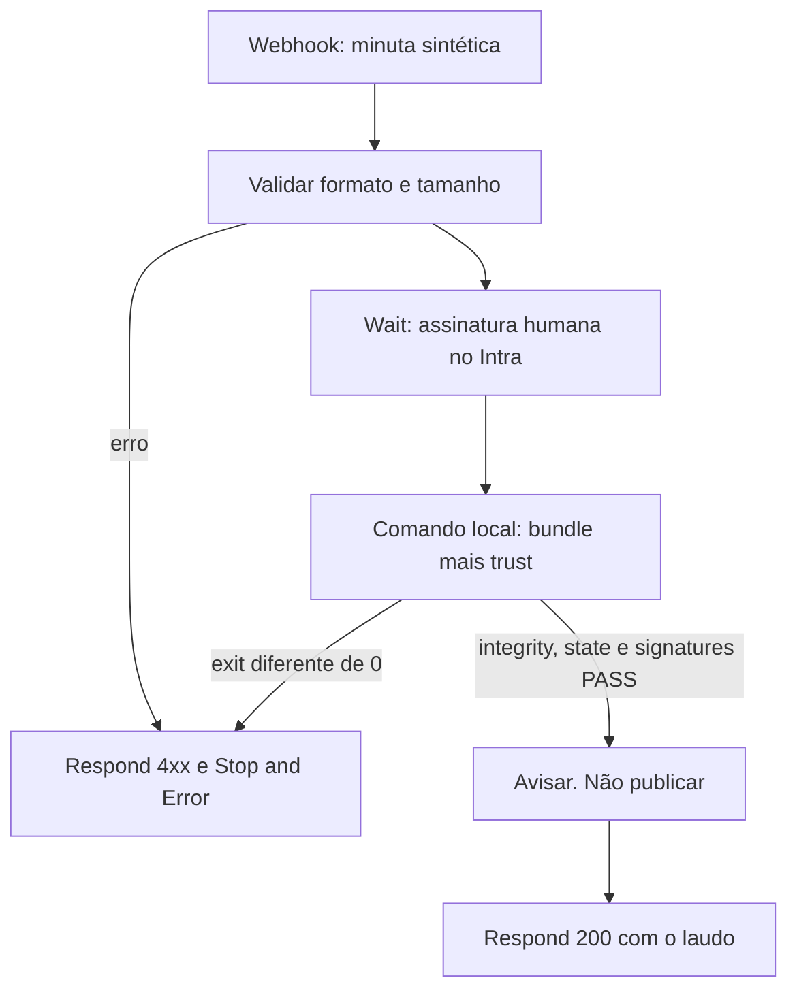

# Tratativa: orquestração n8n e verificação Arkhe

Proposta de 16/11/2026. Vale como conversa técnica entre o founder do Arkhe e quem opera fluxos n8n. Não é contrato social, não cede equity e não autoriza apresentação a cliente antes da aceitação escrita no final.

O prazo de noventa dias começa na data em que os dois aceitam por escrito. Até lá, introdução a empresa fica parada.

## O que cada um integra

O n8n orquestra ferramentas que a empresa já usa: formulário, pasta, e-mail, planilha, CRM. O Arkhe confere um pacote de evidência do Intra e não autoriza a transição. A arquitetura em [docs/ARCHITECTURE.md](../ARCHITECTURE.md) deixa adapters sem autoridade: um resultado de verificação não concede autorização. Cognição propõe e não recebe chave.

Não existe, no fluxo desta tratativa, API HTTP do Intra para o n8n chamar. Desde 17/11/2026, `packaging/core` expõe `POST /v1/verify` e o comando `arkhe-provenance-mcp mcp` para o recibo `arkhe-receipt/v1`. Esse endpoint não confere o pacote do Intra. O MCP em `integrations/verify-mcp` fala stdio. A ferramenta `verify_artifact` calcula digest ou canonicaliza JSON e declara `signatureVerification`, `provenanceVerification` e `policyAuthorization` como `NOT_PERFORMED`. Ligar o fluxo nessa ferramenta e seguir adiante seria tratar canonicalização como assinatura.

O encaixe do piloto é o pacote `arkhe-intra/evidence/v1` exportado pelo Intra, conferido por `apps/arkhe-intra/public/offline/verify.mjs`.

## Condição de continuar

`verifyBundle` não emite `verdict: "PASS"`. O campo `verdict` é `FAIL` quando integridade, estado ou alguma assinatura é inválida, e `INCONCLUSIVE` no restante. Ancoragem vem sempre `INCONCLUSIVE`: esse verificador não confere recibo Rekor nem checkpoint. Assinatura só chega a `PASS` com arquivo de confiança obtido por canal independente, papel certo e conta ativa.

O fluxo n8n só avança para um efeito externo quando os três campos abaixo são `PASS` ao mesmo tempo:

| Campo | Valor exigido para avançar |
|---|---|
| `integrity` | `PASS` |
| `state` | `PASS` |
| `signatures` | `PASS` |

Qualquer outro valor, ausência de arquivo, exceção ou timeout para o fluxo. `verdict: "INCONCLUSIVE"` não é sucesso. `anchor: "INCONCLUSIVE"` permanece mesmo no caso em que os três campos passam, e o efeito externo desse piloto é só um aviso. Publicar, escrever em sistema de terceiro ou marcar o documento como ancorado fica fora.

## Forma do fluxo

Instância n8n auto-hospedada, na empresa ou em quem opera o fluxo. n8n Cloud não entra: o pacote e as chaves não saem para um serviço de terceiro, e o passo de verificação precisa executar um comando local. A licença Sustainable Use do n8n é leitura de quem opera a instância antes de cobrar por hospedar o n8n. Esta tratativa não inclui revender o n8n nem embuti-lo no Arkhe.



Nós e documentos de referência do n8n:

- Webhook com resposta adiada para o nó Respond to Webhook. [Respond to Webhook](https://docs.n8n.io/integrations/builtin/core-nodes/n8n-nodes-base.respondtowebhook/).
- Cada nó que pode falhar usa a saída de erro (`onError: continueErrorOutput`), e essa saída responde e para. Sem isso, o ramo de sucesso continua. Padrão descrito em [n8n error handling for webhook APIs](https://github.com/n8n-io/skills/blob/main/skills/n8n-error-handling-official/references/API_WORKFLOWS.md).
- Wait em On Webhook Call, com `$execution.resumeUrl`, para a assinatura humana. [Wait](https://docs.n8n.io/integrations/builtin/core-nodes/n8n-nodes-base.wait/). A URL de retomada não carrega o documento.
- Execute Command só na instância auto-hospedada, chamando o comando local desta tratativa. Código de saída diferente de zero cai no ramo que para.
- Stop and Error depois da resposta de erro, para o ramo não seguir.

A primeira execução usa minuta sintética. Documento da empresa só na máquina dela, com o [termo da tarde](piloto.md) ainda por escrito, e nunca na máquina de quem desenvolve o Arkhe.

## Comando local

O verificador do pacote Intra está em `apps/arkhe-intra/public/offline/verify.mjs`. O comando que o fluxo chama, sem rede, é:

```powershell
node apps/arkhe-intra/scripts/n8n-gate.mjs bundle.json trust.json
```

Ele imprime o JSON de `verifyBundle` e termina com saída 0 somente quando `integrity`, `state` e `signatures` são `PASS`. Qualquer outra combinação, arquivo ausente ou pacote ilegível termina com saída diferente de zero. Não assina, não admite, não publica e não chama Rekor. Saída 0 com `verdict` e `anchor` em `INCONCLUSIVE` é o caso íntegro: o aviso pode seguir, a publicação não.

O fluxo executado está em `apps/arkhe-intra/n8n/arkhe-gate.workflow.json`. O gatilho manual chama `scripts/n8n-gate.mjs`. A saída de sucesso vai só para o nó Avisar. A saída de erro vai só para o nó Parar, com a mensagem “Pacote não conferido. Aviso não enviado.” O nó Conferir pacote usa `onError: continueErrorOutput`. Sem isso, o erro não teria ramo.

Em 16/11/2026 esse fluxo rodou no n8n 2.47.7 auto-hospedado, com `NODES_EXCLUDE=[]`, `N8N_ENABLE_EXECUTE_COMMAND=true` e `N8N_RUNNERS_ENABLED=false`. O comando foi `node apps/arkhe-intra/scripts/run-n8n-workflow.mjs`. No pacote adulterado executaram Conferir pacote e Parar; Avisar não executou e o arquivo de aviso não foi criado. No pacote íntegro executaram Conferir pacote e Avisar; Parar não executou. Webhook e Wait, que esperam a assinatura humana, não entraram nessa execução: o CLI do n8n começa no gatilho manual. A instância de quem opera o fluxo ainda precisa colocar esses dois nós em volta deste miolo, na máquina da empresa.

O teste `apps/arkhe-intra/tests/n8n-gate.test.mjs` cobre o comando sem subir o n8n. O n8n instalado para a execução fica em `tmp/n8n-local` e não entra no repositório.

`arkhe-verify` no repositório permanece o que o CLI já é: perfis de release, custódia, ausência e GGUF de laboratório. Não é o verificador deste pacote de minuta, e o fluxo não deve apontar para `verify_artifact` no MCP.

Entrega de quem opera o n8n:

Webhook e Wait em volta do miolo já executado, na instância auto-hospedada da empresa, com `NODES_EXCLUDE` permitindo Execute Command. Nota de operação: onde a instância roda, quem guarda o trust, e como a URL de retomada chega a quem assina. O ramo de erro e o aviso já estão no JSON e já foram executados fora dessa instância.

## Divisão

| Atribuição | Founder do Arkhe | Operação n8n |
|---|---|---|
| O que a verificação aceita | Escreve e mantém o comando local | Consome a saída. Não altera o critério |
| Fluxo, fila, formulário, CRM, e-mail | Não configura a conta da empresa | Desenha e opera |
| Intra e chaves | Explica o fluxo de três assinaturas | Não redistribui chave privada |
| Frase dita a uma empresa | Somente [oferta.md](oferta.md) | Não acrescenta selo, custódia, AGI nem preço |
| Introdução | Recebe o cartão de hipótese e decide se a conversa cabe no [piloto](piloto.md) | Indica a empresa. Não marca a reunião no lugar do founder |

Acesso de escrita ao kernel, ao gate e ao `arkhe-verify-core` não faz parte dos noventa dias.

## Propriedade

O repositório Arkhe, o comando local e o critério dos três campos continuam do founder. O JSON do workflow e as credenciais da instância n8n continuam de quem opera o fluxo. O que for marcado pelos dois como comum fica listado num parágrafo à parte, na aceitação. Introdução a empresa não transfere cliente, marca ou participação.

Sem equity neste intervalo. Se uma empresa disser um preço depois de uma tarde realizada, a remuneração dessa introdução se escreve então. Até esse texto, ninguém cobra em nome do Arkhe.

## Aceite dos noventa dias

Os dois consideram o piloto cumprido quando existem, no mesmo ambiente auto-hospedado:

1. Bundle sintético `arkhe-intra/evidence/v1` com trust independente, comando com saída 0, e os três campos `PASS`.
2. Cópia com um byte alterado no corpo, comando com saída diferente de zero, e nenhum nó de aviso executado.
3. Trust ausente ou chave fora do arquivo de confiança: saída diferente de zero, porque `signatures` fica `INCONCLUSIVE`.
4. Registro escrito de que `anchor` continuou `INCONCLUSIVE` e nada foi publicado.
5. Nenhuma frase nova em [deck.md](deck.md). O funil em [piloto.md](piloto.md) só ganha linha se a pessoa da empresa tiver contado um episódio. Rodar o fixture não é tração.

Em 16/11/2026, `node --test tests/n8n-gate.test.mjs` passou os dois testes do comando. No mesmo dia, o fluxo em `n8n/arkhe-gate.workflow.json` rodou no n8n auto-hospedado: o pacote adulterado parou sem executar Avisar, e o íntegro avisou sem passar por Parar. Webhook, Wait e a assinatura humana no meio do fluxo continuam por fazer na instância de quem opera. Esse teste não publica e não preenche o funil.

Fora deste aceite: produção qualificada, Rekor como prova de publicação, agente com autoridade de escrita, e qualquer slide de receita ou capital.

## Aceitação

Nome de quem opera o n8n:

Data:

Aceito o escopo, o critério dos três campos e a ausência de equity neste intervalo.

Nome do founder do Arkhe:

Data:

Aceito entregar o comando local neste escopo e manter a oferta dentro de `docs/mercado/oferta.md`.
