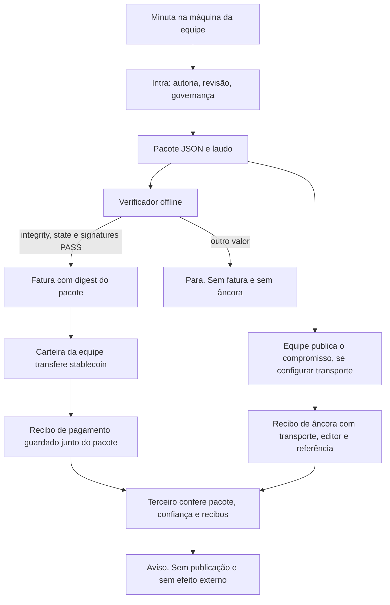

# Projeto web3

Aberto em 17/11/2026. Estrutura o uso de cadeia no Arkhe. Não homologa `arkhe-chain`, não lança token, não adota royalty e não preenche preço, receita ou capital.

A frase da oferta permanece a de [oferta.md](oferta.md). A web3 entra em dois lugares: a equipe pode pagar a mesma venda em stablecoin, e um terceiro pode achar o compromisso do pacote fora da sessão. Verificação continua sem autoridade. `PASS` nos três campos do Intra não publica, não move saldo e não marca o pacote como ancorado.

## O que o projeto entrega

| Peça | Quem opera | O que sai |
|---|---|---|
| Piloto do Intra | Founder e a equipe, na máquina dela | Três assinaturas, JSON exportado, laudo. Igual a [piloto.md](piloto.md) |
| Fatura | A equipe paga de uma carteira que ela controla | Uma transferência de stablecoin, valor único, com referência da fatura |
| Recibo de âncora | A equipe publica, se quiser | Compromisso do pacote num transporte que o recibo nomeia. Sem transporte, a âncora fica pendente |
| Conferência | Qualquer terceiro com o pacote, o arquivo de confiança e o recibo | Os mesmos campos de sempre, mais a leitura do recibo. Âncora ausente não vira confirmação |

## O que fica de fora

- Token, launchpad, NFT de acesso, Unlock, Juicebox, DAO e fluxo contínuo por bloco.
- O split de 10% (8% + 2%). Continua proposta comercial não adotada, como no registro de claims.
- Payout em Bitcoin, `broadcast` e `settled` no `arkhe-chain`. O crate mantém os três fechados. Ver [liquidacao.md](../../kernel/arkhe-chain/docs/liquidacao.md).
- Paybox como caixa da licença. O plugin prepara pagamento voluntário em SOL e não cobra royalty. Ver [plugins/paybox/README.md](../../plugins/paybox/README.md).
- Mandato AP2 como cobrança real. O checker existe. Role externo, executor e pagamento real não estão qualificados. Ver [ACTION-BROKER.md](../ACTION-BROKER.md).
- Contrato EVM que trate assinatura Ed25519 do Intra como autorização. A especificação exige escolher e revisar o mecanismo on-chain. `verifyProof` hoje devolve falso.
- Custódia de chave, dever fiduciário, selo regulatório e agente que decida sozinho. Já estão fora da oferta.

## O que já existe e em que estado

| Peça | Onde | Estado que este projeto aceita |
|---|---|---|
| Intra e verificador offline | `apps/arkhe-intra` | Demo local. Três assinaturas e exportação. `anchor` permanece `INCONCLUSIVE` no verificador do pacote de minuta |
| Cadeia local | `kernel/arkhe-chain` | Nó local. A3 e A4 pendentes. Âncora de 37 bytes aceita no checker. Não transmite |
| Ponte de validade | `contracts/ArkheValidityBridge.sol`, `contracts/Groth16Verifier.sol` | `VerifierAbsent`. Sem pairing e sem envio a rede |
| Mandato e pagamento | `verification/crates/arkhe-verify-core/src/payment.rs` | Verifica resultado autenticado de um role. Não interpreta SD-JWT cru e não executa transferência |
| Paybox | `plugins/paybox` | Proposta de transferência SOL, teto de 1 SOL, assinatura vazia. Paybox assina se alguém aprovar. Não é recibo do Intra |
| Rekor | Intra, quando configurado | Único transporte de publicação que a demo já sabe bloquear e liberar |

Nenhuma linha desta tabela vira produção porque entrou neste documento.

## Forma

O Arkhe não guarda a chave que paga, não escolhe o destino no lugar da equipe e não trata o hash da transação como prova de que o conteúdo foi aceito. O pagamento prova que aquela transferência ocorreu. O pacote prova o que foi assinado. Os dois se encontram porque a fatura cita o digest e a transferência cita a fatura.

## Objetos

Quatro registros, todos off-chain até a equipe publicar o compromisso. Nenhum carrega prompt, chave privada ou documento.

| Objeto | Campos mínimos | Quem assina |
|---|---|---|
| Pacote | O que o Intra já exporta | Autoria, revisão e governança, Ed25519, na máquina da equipe |
| Fatura | Identificador, digest do pacote, moeda, unidades inteiras, rede, endereço de destino, validade, texto do que foi comprado: piloto ou licença anual de uma instalação | Founder. A equipe confere antes de pagar |
| Recibo de pagamento | Rede, transação, valor, origem, destino, identificador da fatura | Ninguém no Arkhe. A transação é da carteira pagadora. O recibo é a leitura dessa transação |
| Recibo de âncora | Transporte, identidade da cadeia ou do log, digest publicado, editor, referência externa, estado observado, método de verificação | Quem publica. Transporte ausente deixa o estado pendente |

Moeda da fatura em stablecoin: código de três letras já exigido pelo checker de pagamento, unidades inteiras, rede nomeada. A faixa de conversa, ainda sem tabela adotada, é a de 17/11/2026: piloto US$ 800 a US$ 1.500, uma vez; licença anual de uma instalação US$ 3.500 a US$ 7.000, uma vez; três primeiros parceiros com o primeiro ano pela metade, em troca da linha no funil. O número que entra no funil é o que a outra pessoa disser.

## Fases

Cada fase termina num fato que outra pessoa possa apontar. Intenção não fecha fase.

### 0. Conversa

Já está em [piloto.md](piloto.md). A web3 não muda as três perguntas. No fim, além de “pagariam para repetir, e quanto?”, cabe uma pergunta de trilho: a transferência seria em reais ou em stablecoin de uma carteira da organização.

Sai quando uma linha do funil tem data, cargo, episódio, exportação terminada pela outra pessoa e o preço que ela disse, com o trilho anotado. Zero e recusa fecham a linha do mesmo jeito.

### 1. Fatura sem transmissão

Arquivo de fatura ao lado do pacote exportado. Cita o digest. Não contém chave. Não chama RPC. Não monta transação.

Sai quando um teste local recusa fatura com digest diferente do pacote, valor zero, moeda fora de três letras maiúsculas, rede vazia e validade vencida. O teste não é pagamento.

### 2. Pagamento operado pela equipe

A equipe monta e assina a transferência na carteira dela, no valor e no destino escritos na fatura, com o identificador da fatura nos dados que a rede permitir. O Arkhe guarda a referência que ela colar. Não pede seed e não transmite.

Sai quando o recibo de pagamento cita a fatura, e uma referência trocada ou um valor diferente fica `INCONCLUSIVE` no cruzamento. Cruzar não é confirmar a cadeia: sem cliente de leitura configurado pela equipe, o estado observado é “referência recebida”, não “transação confirmada”.

### 3. Âncora operada pela equipe

Transporte escolhido por ela, um de cada vez. Ordem de preferência, porque já há código ou demo:

1. Rekor, se ela configurar. A demo do Intra já bloqueia publicação sem isso.
2. Compromisso de 37 bytes no formato que `check_btc_op_return` aceita, publicado por ela. O crate continua sem transmitir.
3. Citação de bloco de execução, no formato que `cite_ethereum_execution` já guarda. `settled` continua falso. Confirmação não entra no arquivo sozinha.

Sai quando o recibo de âncora nomeia transporte, referência e estado observado, e quando âncora ausente ou cliente ausente permanece pendente. `VerifierAbsent` não vira sucesso.

### 4. Efeito externo, ainda só aviso

Igual à tratativa n8n: aviso somente com `integrity`, `state` e `signatures` em `PASS`. O recibo de pagamento e o de âncora podem seguir no mesmo aviso. Publicar, escrever em sistema de terceiro ou marcar o documento como ancorado continua fora.

Sai quando o ramo de erro não avisa e o ramo íntegro não publica. Contrato, ponte ZK e role AP2 real esperam revisão própria e não são critério desta fase.

## Onde o trabalho novo mora

Não abre workspace, não altera Paybox, não liga `arkhe-chain` a uma rede e não põe chave no Intra.

| Fase | Lugar | O que entra |
|---|---|---|
| 0 | [piloto.md](piloto.md), funil | Coluna de trilho na anotação da conversa. A tabela segue vazia até a conversa |
| 1 | Teste ao lado do exportador do Intra | Fatura JSON e os negativos da fase 1 |
| 2 | O mesmo teste, com recibo colado pela equipe | Cruzamento local de identificador, valor e destino |
| 3 | Recibo de âncora no pacote exportado | Estado observado. Sem cliente, pendente |
| 4 | Fluxo já descrito em [tratativa-n8n.md](tratativa-n8n.md) | O aviso pode citar os dois recibos. O comando local continua sem rede |

`kernel/arkhe-chain`, `contracts/` e `plugins/paybox` permanecem o que a tabela de estado diz. Mudança neles pede gate próprio, não esta estrutura.

## Papéis

| Papel | Faz | Não faz |
|---|---|---|
| Founder | Demo, fatura, suporte da licença anual | Operar a carteira da equipe, guardar a chave dela, completar a exportação no lugar dela quando a reunião for tração |
| Equipe | Assina no Intra, paga se quiser, publica a âncora se configurar | Tratar o Arkhe como custódia ou como selo |
| Terceiro | Roda o verificador com o pacote e o arquivo de confiança | Ganhar autoridade porque leu um bloco |
| Transporte | Guarda o compromisso que a equipe publicou | Autorizar a minuta |

## Critério de pronto deste documento

Este arquivo está pronto como estrutura. Não está pronto como produto. Produto, aqui, começa na primeira linha do funil com exportação feita por outra pessoa. Até lá, fase 0 é o trabalho, e as fases 1 a 4 não se implementam para preencher o slide de receita.
