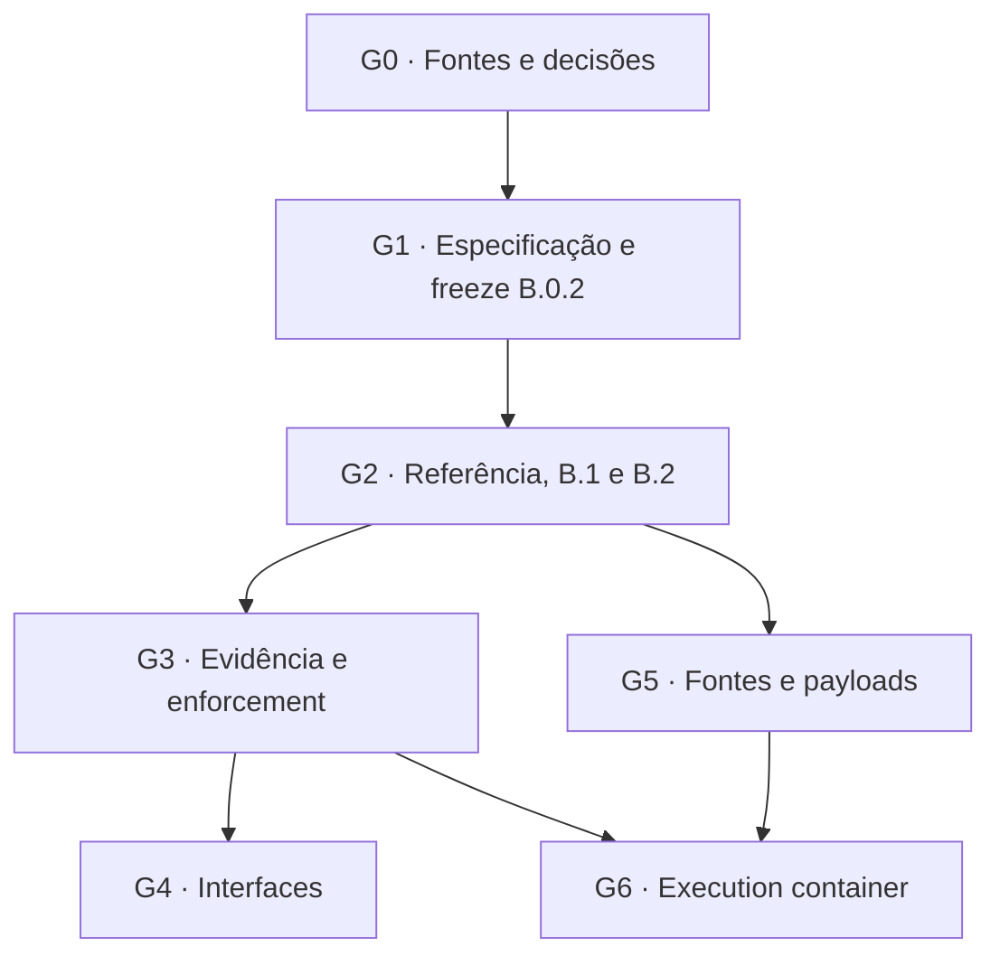

# Plano de implementação verificável — Arkhe

**Estado: plano proposto; tarefas não executadas. Data: 16/10/2026.**

Fonte primária: `Texto colado.txt`, 19,221 linhas, 714,416 bytes.
SHA-256 dos bytes originais: `e2ba86120a90cbe151bafff8ec112487c951d97fdba5db6d4e0615f33458c852`.
Referências `Lx–Ly` apontam exclusivamente para essa cópia, sem renumeração.
O SHA-256 é identificador de proveniência desta revisão, não um digest AKG.

## 1. Ordem e responsabilidades

Não atribuí prazos nem responsáveis pessoais sem dados de equipe. “Responsável” indica função a designar. A existência de um plano não fecha os requisitos.



O ramo de pesquisa pode adiantar coleta de fontes, mas não autoriza alterar bytes normativos silenciosamente. Trabalho exploratório anterior ao gate deve ser rotulado como tal e não gera conformidade oficial.

## 2. Tarefas e aceite

### T01 — Arquivar fonte e imports

**Gate:** G0. **Função responsável:** Responsável normativo.
**Depende de:** nenhuma. **Trata:** F01, F02.

**Entrega:** Manifesto com corpus, RFC-0001, RFC-0002 e B.0.1 identificados, classificação e aprovação.

**Aceite:** Todo import resolve para bytes/version fixados; fonte ausente continua OPEN.

### T02 — Ratificar regras de precedência e histórico

**Gate:** G0. **Função responsável:** Responsável normativo.
**Depende de:** T01. **Trata:** F01, F03, F05, F06, F07.

**Entrega:** Decision log com cláusula selecionada e cláusula superseded por conflito.

**Aceite:** Exatamente uma regra por decisão; título FROZEN sem evidência não aprova release.

### T03 — Fechar VerificationMethod

**Gate:** G1. **Função responsável:** Autor de especificação.
**Depende de:** T02. **Trata:** F04.

**Entrega:** Definições nominais dos seis aliases, semântica dos resultados e preimage de result_digest.

**Aceite:** Cada tipo tem representação e limites; nenhum result_value adicionado sem emenda aprovada.

### T04 — Fechar PolicyResolutionProfile

**Gate:** G1. **Função responsável:** Autor de especificação/segurança.
**Depende de:** T02. **Trata:** F03, F09.

**Entrega:** Profile que define bytes, algoritmo, referências, dependências externas e reprodução da avaliação.

**Aceite:** Artefato alterado falha no digest; referência igual não autoriza conteúdo diferente; resolução não usa estado mutável implícito.

### T05 — Resolver identidade e normalização

**Gate:** G1. **Função responsável:** Autor de especificação.
**Depende de:** T02. **Trata:** F11.

**Entrega:** Regras por scheme, tratamento NFC e rejeição de colisões/entradas não canônicas.

**Aceite:** Teste com caracteres combinantes e identificadores opacos não produz alias silencioso.

### T06 — Completar a field matrix

**Gate:** G1. **Função responsável:** Autor wire.
**Depende de:** T03, T04, T05. **Trata:** F05, F06, F07, F12.

**Entrega:** Schema/registry: presença, tipo, bounds, cardinalidade, sort key, duplicatas e condicionais para cada campo.

**Aceite:** Nenhuma célula TBD ou alias não resolvido; cinco coleções não vazias; unknown field/tag/enum rejeitado.

### T07 — Congelar registry de domínios e assinatura

**Gate:** G1. **Função responsável:** Revisor criptográfico.
**Depende de:** T06. **Trata:** F13, F16.

**Entrega:** Registry com hex, tamanho derivado, mensagem assinada, resolução de chave e critérios exatos de verificação.

**Aceite:** NUL vs caracteres barra/zero diferem; chave/signature inválidas rejeitam; DomainPolicy continua ausente enquanto deferred.

### T08 — Fechar contexto de avaliação e validade

**Gate:** G1. **Função responsável:** Segurança de protocolo.
**Depende de:** T04, T06. **Trata:** F09, F16.

**Entrega:** Regras de matching nested/enclosing policy, chave/autorização, freshness e validade atual.

**Aceite:** Policy conflitante, contexto desconhecido e autor não autorizado nunca produzem elegibilidade.

### T09 — Fechar entradas da closure e profile de estado

**Gate:** G1. **Função responsável:** Autor M6.
**Depende de:** T06, T08. **Trata:** F14, F15.

**Entrega:** Definições de B/F/R/P, intervalo, dependências, universo finito, estado completo e habilitação.

**Aceite:** Base ambígua e referência ausente não reduzem closure para permitir promoção; bounds e erro definidos.

### T10 — Materializar snapshot autocontido

**Gate:** G1. **Função responsável:** Responsável normativo.
**Depende de:** T03, T04, T05, T06, T07, T08, T09. **Trata:** F01, F02, F12.

**Entrega:** Snapshot completo com imports fechados, schema, registry e manifesto aprovado.

**Aceite:** Nenhum bloco histórico ou proposta entra por varredura recursiva do corpus.

### T11 — Executar FindingPropagationAudit

**Gate:** G1. **Função responsável:** Revisor semântico.
**Depende de:** T10. **Trata:** F08.

**Entrega:** Relatório por campo, regra comportamental, referência e decisão.

**Aceite:** Zero severity em fatos; todos os predicados bloqueadores dependem de disposição válida sob policy.

### T12 — Executar PolicyDigestPropagationAudit

**Gate:** G1. **Função responsável:** Revisor semântico.
**Depende de:** T10. **Trata:** F09.

**Entrega:** Relatório de todos os usos security-relevant e bindings alcançáveis e cobertos.

**Aceite:** Nenhum binding ausente, mutável ou incompatível; artefatos e profiles resolvem deterministicamente.

### T13 — Decidir freeze B.0.2

**Gate:** G1. **Função responsável:** Responsável de release.
**Depende de:** T11, T12. **Trata:** F01.

**Entrega:** Release manifest com snapshot, schema, registry, approvals e ambos os relatórios vinculados.

**Aceite:** Todos os gates completos e relatórios reproduzíveis; caso contrário NOT_FROZEN.

### T14 — Implementar referência E0

**Gate:** G2. **Função responsável:** Engenharia de protocolo.
**Depende de:** T13. **Trata:** F10, F12, F13.

**Entrega:** Codec, projeções unsigned, digests e assinaturas conforme profile congelado.

**Aceite:** Testar boundaries, duplicatas, CBOR não determinístico, self-digest, comprimento e desconhecidos; nenhum fallback permissivo.

### T15 — Criar e revisar B.1

**Gate:** G2. **Função responsável:** Engenharia/revisor independente.
**Depende de:** T14. **Trata:** F19.

**Entrega:** Vetores com input bruto, canonical bytes, preimage, digest, assinatura quando aplicável e decisão esperada.

**Aceite:** Oráculos revisados além do gerador; positivos e negativos, mudanças de policy e formatos históricos explicitamente recusados.

### T16 — Implementar verificador independente e B.2

**Gate:** G2. **Função responsável:** Segunda implementação.
**Depende de:** T15. **Trata:** F19.

**Entrega:** Implementação que não reutiliza o mesmo codec/gerador; relatório de paridade por vetor.

**Aceite:** Decisões e bytes exatos coincidem; divergência bloqueia release; duas compilações da mesma biblioteca não bastam.

### T17 — Fechar propriedade M6

**Gate:** G2. **Função responsável:** Engenharia formal.
**Depende de:** T09, T15. **Trata:** F14, F15.

**Entrega:** Obrigação formal de monotonicidade/terminação e semântica de comutação no domínio.

**Aceite:** Contraexemplos base-only/observacional falham; certificados estruturais cobrem acessos; nenhum teste finito é anunciado como prova universal.

### T18 — Implementar EvidenceBundle detached

**Gate:** G3. **Função responsável:** Engenharia de evidência.
**Depende de:** T15, T16. **Trata:** F19.

**Entrega:** Envelope e referências de conteúdo sem circularidade, com localização separada de identidade do payload.

**Aceite:** Trocar URI mantendo bytes não muda subject digest; alterar bytes invalida o binding. URI assinada pode mudar o digest do enclosing record.

### T19 — Implementar enforcement e commit

**Gate:** G3. **Função responsável:** Engenharia de core/segurança.
**Depende de:** T16, T17, T18. **Trata:** F16, F17.

**Entrega:** Decisão nativa, autorização externa e operação protegida com precondição atômica.

**Aceite:** Replay, branch alterado e troca de policy entre avaliar/commit bloqueiam; crash não deixa promoção parcial.

### T20 — Integrar interfaces sem autoridade própria

**Gate:** G4. **Função responsável:** Engenharia de produto.
**Depende de:** T19. **Trata:** F20.

**Entrega:** Adaptadores web/CLI/Tauri que invocam a mesma autoridade e apresentam estados honestos.

**Aceite:** UI adulterada não promove estado; Design.md descreve apenas capacidades demonstradas; variantes de idioma não mudam decisões.

### T21 — Verificar fontes e adaptar payloads

**Gate:** G5. **Função responsável:** Pesquisa/segurança de fornecedores.
**Depende de:** T15. **Trata:** F18, F19.

**Entrega:** Bibliografia resolúvel, versões e avaliação de bibliotecas, parsers e integrações.

**Aceite:** Nenhum benchmark sem método, CVE sem registro ou fornecedor sem avaliação vira garantia do produto.

### T22 — Avaliar execution container

**Gate:** G6. **Função responsável:** Arquitetura/segurança.
**Depende de:** T19, T21. **Trata:** F17, F19.

**Entrega:** PoC isolada com threat model, budgets e interfaces explícitas.

**Aceite:** Só avança com fundamentos congelados e testes de escape/falha; existência de crate não equivale a aprovação.

## 3. Gates de release

| Gate | Evidência obrigatória | Impede avanço |
|:---|:---|:---|
| G0 | Fontes identificadas e decisões de precedência | Import ausente, conflitante ou sem identidade |
| G1 / B.0.2 | Tipos/preimages completos, schema e registry aprovados, dois audits executados | Qualquer TBD, fonte ambígua ou audit sem relatório |
| G2 / B.1 | Vetores brutos com resultados esperados revisados | Oráculo só produzido pela implementação sob teste |
| G2 / B.2 | Implementação independente e relatório por vetor | Biblioteca compartilhada como única independência ou divergência aberta |
| G3 | Trust boundaries e transições protegidas testadas | Promoção por UI, replay, policy/contexto trocados ou commit parcial |
| G4 | Jornada de criadores corresponde às capacidades reais | Promessa de autoria, saque ou monitoramento sem recurso demonstrado |
| G5–G6 | Parsers, dependências e execução avaliados | Artefato assinado tratado como automaticamente seguro |

Nenhum resultado do script desta revisão substitui esses relatórios.

## 4. Primeira unidade de trabalho

Começar por T01–T02. A próxima entrega técnica deve trazer os imports exatos e a tabela de decisões de precedência. Em seguida, T03 e T04 fecham os dois bloqueios explícitos. T05–T09 devem ser resolvidos ou demonstrados por import autenticado antes de T10.

A saída aceita de T03 não é “tipos corrigidos”: é um artefato com tipos, limites, preimage e referências. A saída aceita de T04 não é “hash de policy”: é a receita reproduzível que identifica o artefato efetivamente avaliado.

## 5. Relação com a aplicação para criadores

O trabalho normativo é infraestrutura interna. A aplicação de criadores e o Design.md têm trilha própria de linguagem e usabilidade. Não se promete que o app já contenha native enforcement, B.2 ou o protocolo AKG por mostrar um recibo de rede de teste.

Após implementação, os termos internos são traduzidos conforme Design.md. Tradução não troca o significado: registro continua registro; igualdade de arquivo não verifica titularidade; saldo de teste não vira saque bancário. Capacidades ainda ausentes permanecem ausentes na interface pública.

## 6. Como conferir esta entrega

Extrair o pacote e executar, com Python 3:

```sh
python3 verify_review.py --source /caminho/Texto-colado.txt
```

Usar o anexo original, sem alterar quebras de linha ou bytes. O verificador confere o SHA-256 e os arquivos documentais, produzindo um relatório local. Não acessa serviços, não executa payloads e não cria um PASS normativo AKG.

Para rastrear decisões: `source-index.json`, `normative-rules.json`, `audit-findings.json`, `implementation-tasks.json` e `external-evidence.json`. O pacote contém também os domínios e os resultados locais. O original completo continua sendo a fonte para leitura contextual.
