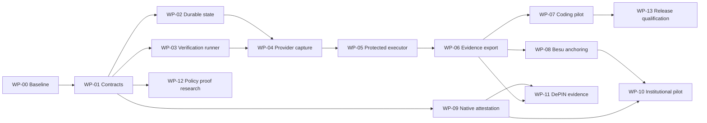

# Arkhe Implementation Plan

Version: 0.1 proposal. Date: October 21, 2026. Language: English (US).

This plan implements the [technical specification](TECHNICAL-SPECIFICATION.md). It proposes future work; checkmarks or passing implementation results are not implied. Owners below are required roles, not assigned people. Calendar dates and estimates require staffing and environment decisions.

## 1. Delivery strategy

Deliver a durable coding workflow first. Extend existing checkpoint anchoring next. Qualify hardware and consortium integrations independently. Keep ZK policy proofs and financial enforcement outside the first pilot.

Do not rebuild working core crates merely to reproduce the attachment's directory tree. Reuse existing code where its profile, authority boundary, and evidence satisfy the target contract. Do not add empty modules to inflate completion.

WP-13 operational requirements begin during WP-01; the final gate occurs after the selected pilot. WP-12 is not on the coding pilot's critical path. Institutional and DePIN releases require their additional qualification gates even if the coding pilot has passed.

## 2. Baseline and contracts

### WP-00 — Reproducible baseline

Owner: repository maintainer. Dependency: none.

Deliverables: immutable source inventory, architecture/profile map, selected environment, retained validation logs, and a delta against the existing reports. Identify parent Arkhe, AGI Coder, B0 Besu, and workload-attestation boundaries separately.

Acceptance: run the documented Rust build/tests/lints/format checks, Python contract tests, and TypeScript build/tests for the chosen revision. Preserve skipped-test reasons and failures. Review the existing parent PostgreSQL journal before proposing a new adapter. Record unavailable hardware and services explicitly.

Stop condition: an unexplained baseline failure blocks a capability promotion. Documentation can proceed while the defect is recorded; deployment qualification cannot.

### WP-01 — Versioned contracts and authority ADRs

Owner: kernel maintainer with security reviewer. Dependency: WP-00.

Deliverables: versioned schemas for tenant-scoped intents, provider capture, verification evidence, durable authorization, effect receipts, checkpoint/trust packages, and API errors. Add ADRs for profile interoperability, dispatch versus protected-action authorization, key custody, trust-root distribution, and revocation semantics.

Acceptance: static positive/negative vectors; cross-language canonicalization where supported; rejection of unknown versions; changed tenant/requester/parameters/output/policy fails the appropriate binding test. Specify absent versus empty values, timestamp units, integer ranges, maximum sizes, and algorithm identifiers.

Compatibility gate: retain existing vectors and immutable migration checksums. A new profile must not masquerade as either current parent Arkhe or `AGI/*/v1`.

## 3. Durable coding workflow

### WP-02 — Durable admission, outbox, and reconciliation

Owner: storage/runtime engineer. Dependency: WP-01.

Implementation locations: extend `agi-coder-journal` behind an explicit storage interface; evaluate `integration/arkhe-bugbounty/src/postgres.rs` for reusable semantics, not direct schema equivalence. Add migrations rather than editing published migrations.

Deliverables: transactional admission/outbox, state history, worker leases/fencing, tenant isolation, recorded remote IDs, bounded dispatch policy, and authorized reconciliation commands.

Acceptance: concurrent exact retries produce one admitted dispatch; changed immutable bindings conflict; a restarted process returns the durable outcome; stale lease holders cannot complete; expired leases do not blindly resubmit ambiguous jobs. Inject crashes before/after each local commit and remote submission. Verify least-privilege database access and cross-tenant rejection.

No automatic resume to production effects is permitted until uncertain-write tests pass.

### WP-03 — Immutable candidate and independent verification runner

Owner: verification engineer with platform-security reviewer. Dependency: WP-01.

Implementation locations: `agi-coder-verification`, `agi-coder-pipeline`, and a separately controlled runner.

Deliverables: base/candidate materialization, artifact manifest, runner-image identity, bounded execution policy, baseline/regression/property checks, caller-approved mutation campaign, captured stdout/stderr and test artifacts, and verification-envelope signing.

Acceptance: substituted files or candidate commits are rejected; traversal/symlink escapes fail; malicious tests cannot read a canary secret or write outside the allowed workspace; time/output/process limits terminate the runner predictably. A failing baseline, empty suite, skipped mandatory check, or altered test artifact denies authorization. Verify the combined artifact after merging independently generated changes.

Independence gate: selecting a different model name or author string alone is insufficient. Record who selected the oracle, who controlled execution, and who may sign the resulting evidence.

### WP-04 — Jules and local-inference adapters

Owner: provider-integration engineer. Dependencies: WP-02 and WP-03.

Implementation locations: existing `agi-coder-jules`, `agi-coder-inference`, and provider-to-WER composition.

Deliverables: complete activity pagination/capture, patch/base validation, provider request/session mapping, host-observed verification, provider-specific timeout/reconciliation rules, and deterministic replay fixtures. Keep DeepInfer proposals labeled unverified until WP-03 qualifies the artifact.

Acceptance: malformed/unknown activities fail conservatively when required evidence cannot be established; incomplete pagination is detected; missing provider tests are not fabricated. A create timeout produces an uncertain outcome without duplicate submission. Perform one authorized live test in a designated repository only after local tests pass; retain provider ID, exact candidate, test artifacts, and receipt.

External prerequisite: a scoped provider account, test repository, allowed budget, and documented permissions. Native DeepInfer qualification requires its own compatible hardware environment.

### WP-05 — Protected executor and review enforcement

Owner: runtime engineer with repository administrator. Dependencies: WP-02, WP-03, and WP-04.

Deliverables: one concrete protected action, such as applying a verified candidate to a designated integration branch; capability validation/consumption; fresh branch/base checks; enforced review routing; reconciliation of uncertain remote outcomes; and no-provider-credential bypass paths.

Acceptance: forged capabilities, changed output/base/policy, replay, revocation, and expired authorizations fail. Direct effect attempts without the executor's authorization are blocked by permissions. The exact tested candidate is the exact applied artifact. Moving the target branch during verification requires re-evaluation rather than silent merge.

Scope gate: success on an integration branch does not authorize protected-main merges, deployments, releases, or financial transactions.

### WP-06 — Portable evidence and checkpoint authenticity

Owner: verification/SDK engineer. Dependencies: WP-01 and WP-05.

Deliverables: versioned export package, separate trust configuration, component-level verifier output, durable MMR append/checkpoint persistence, signer/key-history metadata, optional external-anchor adapter, and Rust/TypeScript parity for each supported profile.

Acceptance: verify offline with independently supplied trust configuration. Alter the record, artifact, signature, checkpoint, leaf count/index, peak order, profile, or anchor reference and confirm the corresponding rejection. A self-consistent forged package with an untrusted root must fail the trust check. Restart preserves append order/checkpoints. Missing private bytes are disclosed as a verification limitation.

Performance gate: publish measured append/proof/export latency and storage usage at agreed sizes. Do not assign asymptotic performance claims to an implementation that rebuilds the entire forest.

### WP-07 — Bounded coding pilot and user interface

Owner: application engineer with pilot operator. Dependencies: WP-02 through WP-06.

Deliverables: one end-to-end workflow, authenticated operation/status/evidence APIs, CLI or minimal dashboard, review/reconciliation views, pause/cancel semantics, and a long-horizon checkpoint/resume exercise. Optional desktop packaging follows the same APIs.

Acceptance: an operator can submit, inspect, resume after restart, review, apply the permitted action, and verify exported evidence independently. The UI shows estimated versus measured cost, missing checks, expired evidence, and unknown outcomes. No success badge appears for provider completion alone.

For existing interfaces, maintain separate scopes: Intra's native-kernel admission, Preflight's chain/finality checks, Melodic's actual audio pipeline, and Chladni's read-only observability. Prior UI test success does not imply these distinct native integrations are finished.

Exit gate: meet the failure matrix in Section 7 and the operational targets agreed in WP-01. Publish the evidence package, known limitations, and reviewer decision.

## 4. Besu and institutional track

### WP-08 — Qualify existing B0 anchoring

Owner: EVM integration engineer. Dependencies: WP-01 and WP-06.

Implementation locations: existing `ops/besu`, `scripts/besu_b0.py`, checkpoint exporter, registry contract, and verification adapters.

Deliverables: pinned source/image/contract identities, durable checkpoint/receipt records, explicit chain/genesis/registry/publisher bindings, controlled retry and reconciliation behavior, and independent receipt/read-back verification.

Acceptance: correct checkpoint anchors once; exact retries recover the same result; conflicting checkpoint/index and unauthorized publishers fail. Wrong chain, wrong contract/code, tampered checkpoint, reverted receipt, and dishonest RPC responses cannot produce a verified-anchor result. Retain evidence without wallet secrets.

Local single-host validators remain a mechanics test. Do not label this gate an independent consortium or Agglayer qualification.

### WP-09 — One native attestation profile

Owner: confidential-computing engineer with independent security reviewer. Dependency: WP-01; may proceed alongside the coding pilot.

Deliverables: choose one hardware/platform profile, integrate a native verifier through the existing wrapper, define accepted measurements and trust roots, implement verifier-generated freshness challenges, bind workload key/job/artifact, and document refresh/expiry enforcement.

Acceptance: valid real evidence from the chosen hardware passes; wrong nonce, substituted workload key, stale/future token, disallowed debug/TCB state, changed measurements, malformed certificate/JWT, unknown issuer, and revoked roots fail. Test a refresh outage and demonstrate that future key release/protected effects stop as specified.

Qualification gate: fixtures and a parsed token are insufficient. Retain raw evidence, validation result, hardware/firmware/configuration identity, and reviewer decision. Additional platforms require separate gates.

### WP-10 — Institutional Besu pilot

Owner: consortium/platform lead. Dependencies: WP-08 and WP-09 for any attested-validator claim.

Deliverables: organization-to-validator/key registry, onboarding evidence policy, selected protected application contract/executor, unavoidable authorization boundary, validator-change governance, and a documented trust map for any requested cross-chain extension.

Acceptance: direct transaction submission cannot bypass the chosen application's policy; authorization is bound to the actual transaction fields and policy epoch. Exercise validator rotation, key revocation, quorum loss, policy outage, and unauthorized node enrollment. Checkpoint transport and validator admission are evaluated separately.

Agglayer connectivity is a separate sub-gate: pin its components/contracts and certificate policy, execute test transfers in an approved test environment, verify settlement/claim receipts, and test service interruption. Do not redeploy an existing ledger using a new-chain runbook without a reviewed migration design.

## 5. DePIN and research tracks

### WP-11 — Attested job evidence and equivocation detection

Owner: compute-platform engineer. Dependencies: WP-06 and WP-09.

Deliverables: one job/resource integration, authenticated metering, input/model/output commitments, attestation lease, portable evidence, checked cost accounting, and an equivocation detector that produces evidence without moving funds.

Acceptance: transplanted hardware evidence cannot authorize another job/key/tenant; stale refresh blocks the defined next effect; output substitution fails. Two incompatible signed statements in the same canonical slot produce a reviewable conflict package. Ordinary retries, client conflicts, epoch changes, key rotation, and timeouts do not produce a penalty.

Financial enforcement remains disabled until offense definitions, adjudication, appeals, economic parameters, custody, and contracts receive separate approval and testing.

### WP-12 — Private policy-proof feasibility

Owner: cryptography engineer. Dependency: WP-01.

Deliverables: one narrow statement, threat/privacy model, public-input/action binding, circuit/verifier-key governance, proof-system assumptions, benchmarks, and a proceed/stop decision.

Acceptance: a valid statement verifies; changed policy epoch, action, recipient commitment, nullifier, or verifier key fails. Test replay, malformed proofs, witness substitution, and privacy leakage from public inputs. Require an independent circuit/security review before a production pilot.

No dependency on an unrelated bridge proof may stand in for application-policy soundness.

## 6. Operational and release qualification

### WP-13 — Reproducible release and recovery

Owner: SRE/release engineer with security reviewer. Dependency: selected pilot completed; operational work starts earlier.

Deliverables: pinned dependencies, SBOM, provenance, signed artifacts, least-privilege identities, explicit supply-chain policy, backup/restore and key-rotation runbooks, telemetry without secrets, upgrade/rollback procedure, measured cost report, and a signed qualification decision.

Acceptance: rerun clean build and verification against the release candidate; reject unsigned or wrong-subject artifacts; restore durable state into a separate environment; demonstrate configured RPO/RTO; exercise a crash, database outage, provider outage, lease loss, and anchor outage. Verify that rollback does not invalidate interpretation of existing evidence.

Release gate: no unreviewed trust roots, unsupported hardware-success claims, silent bypass paths, unexplained skipped mandatory tests, or unresolved uncertain effects. Specify the exact SLSA requirements satisfied; do not infer a level from a workflow file.

## 7. Mandatory failure matrix

| Test ID | Scenario | Required result | Work package |
| --- | --- | --- | --- |
| AT-01 | Same request concurrently submitted and retried after restart | One admitted dispatch; durable replay/status | WP-02 |
| AT-02 | Same replay slot, different tenant/requester/parameters | Isolation or conflict; no dispatch | WP-01/02 |
| AT-03 | Provider accepted job, response lost | Reconciliation; no blind resubmission | WP-02/04 |
| AT-04 | Lease expires while an old worker remains active | Fencing prevents protected effect | WP-02/05 |
| AT-05 | Candidate/base/test artifact changed after verification | Denial and new verification requirement | WP-03/05 |
| AT-06 | No tests, failing baseline, or skipped mandatory tests | No authorization | WP-03 |
| AT-07 | Candidate attempts filesystem/network/secret escape | Contained failure with retained evidence | WP-03 |
| AT-08 | Provider emits unsupported or truncated activity evidence | Explicit incomplete/unsupported outcome | WP-04 |
| AT-09 | Revoked key or changed policy before effect | Denial at effect boundary | WP-05 |
| AT-10 | Effect succeeded remotely, local acknowledgement lost | Recover existing receipt; no duplicate effect | WP-05 |
| AT-11 | Valid structure, untrusted checkpoint signer/root | Integrity may pass; trust fails | WP-06 |
| AT-12 | MMR/profile/count/path mutation | Verification rejection | WP-06 |
| AT-13 | Wrong chain/registry or fabricated successful RPC receipt | No verified-anchor outcome | WP-08 |
| AT-14 | Attestation replay, wrong workload key, stale lease | Reject key release/protected action | WP-09 |
| AT-15 | Direct submission around the policy gateway | Protected application action fails | WP-10 |
| AT-16 | Client conflict or benign retry mistaken for equivocation | Conflict recorded; no automatic penalty | WP-11 |
| AT-17 | Proof reused for another action or policy epoch | Reject proof/action binding | WP-12 |
| AT-18 | Restore or rollback changes interpretation of prior evidence | Reject incompatible change or preserve versioned verification | WP-13 |

Every test record must include source/configuration digests, environment, inputs, expected/actual results, exit status, logs, and reviewer. Mandatory negative tests cannot be replaced with screenshots or a successful happy path.

### Security requirement traceability

| Specification requirement | Primary implementation | Acceptance scenarios |
| --- | --- | --- |
| SEC-01: admission before dispatch | WP-02/04 | AT-01, AT-03 |
| SEC-02: exact replay and conflicting bindings | WP-01/02 | AT-01, AT-02 |
| SEC-03: exact authorization context | WP-01/05 | AT-02, AT-05, AT-09 |
| SEC-04: tested artifact equals consumed artifact | WP-03/05 | AT-05, AT-07 |
| SEC-05: missing/invalid evidence denies | WP-03/04/06 | AT-06, AT-08, AT-11, AT-12 |
| SEC-06: uncertain effects reconcile | WP-02/04/05 | AT-03, AT-10 |
| SEC-07: independent trust roots | WP-06/09 | AT-11, AT-14 |
| SEC-08: inclusion does not authorize an effect | WP-05/08/10 | AT-09, AT-13, AT-15 |
| SEC-09: recheck revocation and policy | WP-05/09/10 | AT-09, AT-14, AT-15 |
| SEC-10: no unsupported-success fallback | WP-04/06/09 | AT-08, AT-11, AT-14 |

## 8. Decisions required before scheduling

| Decision | Needed for | Proposed starting position |
| --- | --- | --- |
| Initial repository and protected action | WP-01/05 | Designated test repository and integration branch |
| Wire-profile interoperability | WP-01 | Explicit adapters; keep existing profiles distinct |
| Database deployment and migration ownership | WP-02 | Reuse established PostgreSQL operational practices |
| Isolation runtime and network allowlist | WP-03 | Dedicated runner without production credentials |
| Provider account/budget/reconciliation support | WP-04 | One provider and bounded live pilot |
| Key custody and review policy | WP-05/13 | Separate scoped keys and conservative review |
| Retention, RPO/RTO, SLOs, maximum budget | WP-01/13 | Measure pilot load; approve numeric limits before qualification |
| Besu-only anchoring versus cross-chain assets | WP-08/10 | Checkpoint anchoring first |
| Hardware access and approved measurements | WP-09 | One native platform before multi-platform support |
| Licensing, token, royalty, and penalty policy | Commercial/governance work | Preserve current licenses; no automatic economic changes |

## 9. Definition of done

The selected delivery is complete only when its contracts, executable implementation, acceptance matrix, reproducible evidence, operating runbooks, and qualification decision agree on the same source revision and scope. Update the capability register with those references. Retain unresolved work as explicit backlog rather than promoting the entire platform after one successful subsystem test.
