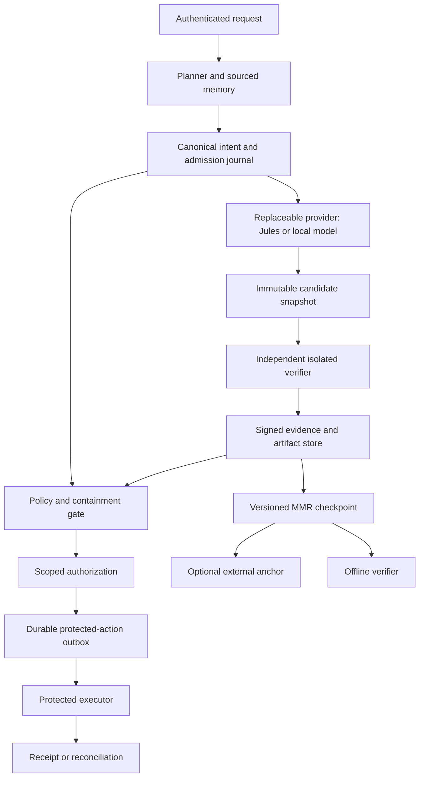
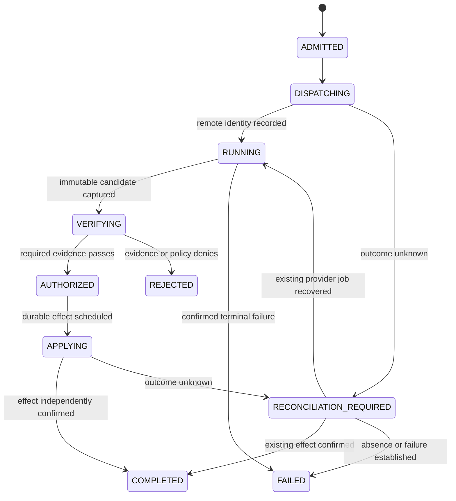

# Arkhe Consolidated Technical Specification

Version: 0.1 proposal. Date: October 21, 2026. Language: English (US).

## 1. Purpose and scope

Arkhe is an evidence and authorization system for protected actions. AGI Coder is a proposed application of that system to coding workflows, combining a replaceable coding provider, independent verification, persistent planning, and cryptographic accountability. The name does not establish general intelligence or unattended production autonomy.

The first release target is one bounded repository workflow: capture a request, generate a candidate through a provider, independently test an immutable candidate, obtain policy authorization, apply an explicitly permitted protected action, and export independently verifiable evidence.

Three extensions share evidence infrastructure but have different trust assumptions: institutional Besu checkpoint anchoring, attested compute for DePIN, and private policy proofs. None is a prerequisite for the first coding pilot.

The terms MUST, MUST NOT, and SHOULD describe proposed acceptance requirements. They do not assert that all requirements already exist in code.

Out of scope for the first release: proving arbitrary program correctness, certifying institutional compliance, launching a token, automatic financial penalties, operating a production consortium, and claiming that every action on an external chain is governed by Arkhe.

## 2. Evidence baseline and status vocabulary

| Area | Baseline inspected | Qualification boundary |
| --- | --- | --- |
| AGI Coder | Fourteen Rust crates, SDK and MCP packages, provider contracts, tests, CLI, DeepInfer bridge | Source and existing local validation report inspected; no new execution in this task |
| AGI Coder journal | In-memory admission, replay, conflicts, terminal states; SQL migration supplied | No production crash recovery or durable runtime adapter |
| Parent Arkhe persistence | Existing PostgreSQL-backed bug-bounty journal and evidence paths | Reuse candidate; does not automatically qualify a different application/profile |
| Independent verification | Finite-domain oracles and actual subprocess mutation campaigns | Caller supplies tests, mutants, and trusted execution environment |
| MMR | Separate parent Arkhe and AGI profiles; Rust/TypeScript verification and reference vectors | Profile identity is mandatory; local roots do not establish public witnessing |
| Jules | REST adapter, activity extraction, conservative review router, local HTTP integration | Live session and protected-action reconciliation remain separate qualification work |
| DeepInfer | Provider interface and bounded Python bridge | Native hardware execution remains unqualified in the inspected report |
| Besu | Existing B0 four-validator local checkpoint-anchoring prototype | Not proof of an independent consortium or an Agglayer deployment |
| Workload attestation | Existing `AttestedWorkerVerifier` composition with injected verification dependencies | Native hardware-verifier qualification remains pending |
| DePIN / policy ZK | Design proposals in the attachments | No end-to-end production implementation established by this review |

Use `PROPOSED`, `SOURCE_INSPECTED`, `LOCAL_VALIDATED`, `CI_VALIDATED`, and `ENVIRONMENT_QUALIFIED`, always with a source revision, environment, and evidence link. These are scoped engineering statuses. Existing `LEMMA`/`THEOREM` terminology may be retained in historical documents but MUST NOT be presented as a mathematical proof or certification.

Baseline references: [AGI architecture](../../../agi-coder/docs/ARCHITECTURE.md), [maturity](../../../agi-coder/docs/MATURITY.md), [historical validation](../../../agi-coder/docs/VALIDATION.md), [B0 prototype](../../../ops/besu/README.md), and [partial workload attestation](../../security/WORKLOAD-ATTESTATION-2026-10-18.md).

## 3. Architecture and authority

The planner, model, provider, browser, and MCP client MUST NOT hold policy-root or protected-action signing authority. The gate decides whether a specific action is authorized; the executor enforces that decision at the effect boundary. A UI success message, provider completion flag, or signed provider statement is insufficient.

Provider job creation is itself an external effect, potentially billable. It requires durable admission and dispatch authorization before submission. Candidate publication or deployment requires a separate authorization based on completed verification. A post-execution WER cannot retroactively authorize the initial provider call.

The main Arkhe workspace remains the authority for its existing profiles. `agi-coder` remains a separate workspace until a reviewed interoperability design specifies the translation boundary. Similar names do not establish compatible encodings or trust policies.

## 4. Threat model and security properties

Assume malicious or compromised providers, forged test summaries, prompt injection in retrieved text, malicious candidate code, cross-tenant replay, stale/revoked keys, evidence-store substitution, worker crashes, ambiguous network responses, and administrative mistakes. A chain/RPC endpoint may lie or become unavailable. An attestation vendor or approved signer remains part of an explicitly documented trust base.

| ID | Required property |
| --- | --- |
| SEC-01 | Every external dispatch MUST have a durable admission record before the effect. |
| SEC-02 | Exact retries MUST return the recorded outcome or current state; changed immutable bindings MUST conflict. |
| SEC-03 | Gate authorization MUST bind expected intent, exact candidate/output, evidence identity, policy revision, tenant, action, and freshness. |
| SEC-04 | Tests MUST run against the exact artifact later consumed by the protected executor. |
| SEC-05 | Missing, invalid, expired, unknown-profile, or unverifiable required evidence MUST deny authorization. |
| SEC-06 | Unknown remote outcomes MUST enter reconciliation; retries MUST NOT silently create duplicate effects. |
| SEC-07 | Evidence verification MUST use independently configured trust roots, not roots supplied solely by the evidence producer. |
| SEC-08 | No network write, merge, key release, transaction, or penalty is authorized merely by a valid MMR inclusion proof. |
| SEC-09 | Revocation and policy changes MUST be rechecked immediately before a protected effect. |
| SEC-10 | Unsupported hardware or provider evidence MUST remain unsupported; no synthetic success fallback is allowed. |

The system detects defined classes of substitution and missing authorization. It does not prove that a trusted signer told the truth, a test suite is complete, a TEE has no vulnerability, or a consortium cannot collude outside the declared model.

## 5. Core contracts and versioning

### 5.1 Intent, identity, and tenancy

An intent MUST identify requester, tenant, operation kind, target, request identity, canonical parameters, schema/profile, and authorization context. Derive a stable replay slot separately from the complete intent digest so that a modified request conflicts with the original slot.

The current AGI implementation derives operation identity from action, target, and request identity; its intent digest additionally binds requester and parameters. Tenant binding and additional policy context are proposed extensions. They MUST use a reviewed new profile or an explicit authenticated outer envelope. Do not silently change existing digest preimages or golden vectors.

Timestamps MUST NOT create a new replay identity for the same request. Server-owned admission time, client-declared time, and attested completion time MUST be distinct.

### 5.2 Worker and verification evidence

The current AGI WER includes operation/intent digests, predecessor, worker, plan, output, test counts, test-artifact digest, self-check, completion time, signer, record hash, and signature. New evidence profiles SHOULD add bindings to repository base commit, candidate tree/artifact digest, runner image, test-suite identity, policy, and provider session capture.

Prefer immutable evidence references and a versioned verification envelope over changing a frozen WER. Keep provider-reported test output separate from host-observed results. Retain failures as audit evidence; a failed run MUST NOT count as successful authorization evidence.

The trusted runner signs only after independently capturing the observed artifacts. A host signature on imported Jules logs authenticates that capture; it does not create a hardware attestation of the provider's VM.

### 5.3 Authorization capability and receipts

The target authorization contract MUST bind tenant, operation, candidate, evidence, policy digest/epoch, allowed effect, expiry, and a consumption identifier. A capability MUST be checked by the executor, not accepted as a caller-provided Boolean. Serialized capabilities require authenticated issuance and replay protection.

An effect receipt MUST capture executor identity, effect type, stable remote identifier, submission/result timestamps, artifact/transaction binding, observed terminal state, and evidence references. Submission, inclusion, finality, and reconciliation are separate states.

The existing AGI capability binds operation/evidence/output in process; the broader durable capability is planned work.

### 5.4 Portable evidence package

A target package contains a manifest, profile/version identifiers, signed records, referenced artifacts or access-controlled references, MMR proof, checkpoint, signer/trust metadata, and optional anchor receipts. Omitted private bytes MUST be explicitly identified as unavailable for independent content verification.

The verifier MUST distinguish structural validity, digest integrity, signature validity, trusted signer, freshness, policy satisfaction, checkpoint authenticity, external anchoring, and execution-correctness claims. Return component results rather than a universal `valid=true` for an incomplete package.

Offline verification MUST disclose its trust/revocation snapshot and the time assumptions used. It can validate against that snapshot; it cannot establish that no newer revocation, policy update, or conflicting checkpoint exists. A requirement for current state needs an authenticated refresh or an explicit inconclusive result.

No private key, bearer token, secret input, raw confidential model prompt, or low-entropy sensitive identifier belongs in a public package. Commitments can leak through guessing or correlation; use reviewed randomized commitments where required and retain the opening only with authorized parties.

## 6. Durable operation state machine

The target state machine is a proposal; it does not replace the current migration by declaration.

Use a tenant-scoped unique replay key, immutable intent binding, compare-and-swap state transitions, lease expiry, fencing tokens, bounded retries, and an append-only transition history. Commit admission and the dispatch outbox entry in one transaction. Use separate outbox records for later protected effects.

Outbox delivery is not an exactly-once guarantee across a database and remote service. Each adapter MUST document remote idempotency support, reconciliation lookup, and behavior when the remote ID cannot be recovered. A timed-out write is not evidence that no write occurred.

Reconciliation MUST preserve the original operation and evidence chain. Terminal records are immutable; operator resolution is a separately authorized, attributable event. Expired leases MUST NOT allow an old worker to apply a protected effect.

## 7. Coding-provider and verification workflow

Google's documented Jules REST API exposes asynchronous sessions and session activities. The adapter SHOULD use the documented contract and capture all pagination and artifacts required by its evidence profile. MCP availability is not assumed. [Jules REST reference](https://developers.google.com/jules/api/reference/rest)

| Step | Required behavior |
| --- | --- |
| Request | Authenticate requester; freeze scope, base commit, budget, allowed tools, and effect permissions. |
| Plan | Build a bounded DAG; identify dependencies, acceptance tests, and checkpoints. Treat retrieved text as untrusted data. |
| Dispatch | Admit durably; authorize provider dispatch; record provider correlation/session identity. |
| Capture | Retrieve the complete candidate and activity evidence; reject ambiguous or incomplete artifacts. |
| Materialize | Apply candidate in an isolated workspace based on the exact recorded base; reject unsafe paths and unexpected base movement. |
| Verify | Run independently selected baseline, regression, property, and mutation tests under resource/network limits. |
| Review | Route using verified results and trusted risk classification; confidence text from a model is insufficient. |
| Apply | Recheck policy, branch/base state, revocation, artifact identity, and capability consumption. |
| Export | Persist outcome and publish an appropriately scoped evidence/checkpoint package. |

Nonzero test failures, empty evidence, skipped mandatory checks, missing baseline, and a failed runner MUST deny the protected action. A suite digest identifies tests; organizational and operational independence require separate controls.

Autonomous test generation remains untrusted proposal generation until an independent oracle or reviewer qualifies the tests. Mutation scores MUST report denominator, equivalent/excluded mutants, timeouts, and baseline outcome. No global score proves semantic correctness.

The existing review router permits a narrow documentation-only path of at most 20 changed lines with passing tests. This specification does not broaden that policy to dependency upgrades, authentication changes, deployments, or financial actions.

Long-horizon planning MUST persist task state, evidence references, retry counts, source provenance, and remaining budget. Resuming MUST revalidate current repository/policy state. Child work receives bounded scope and cannot inherit authorization beyond its parent. Merging partial results requires conflict detection and re-verification of the resulting combined artifact.

## 8. MMR and external anchoring

MMR verification MUST bind leaf count, leaf position, peak layout, path direction, hash domains, and profile version. Reject extra siblings, extra peaks, unsafe integers, malformed digests, and inconsistent counts. Unknown profiles are errors, not an invitation to guess a historical layout.

The existing AGI MMR profile is explicitly different from parent Arkhe. Its current root/proof reconstruction is O(n); the data structure's potential logarithmic properties MUST NOT be advertised as an achieved storage-engine benchmark. See [AGI/MMR/v1](../../../agi-coder/specs/agi-coder/mmr-profile.md).

An authentic checkpoint requires an approved signing/witnessing policy independently obtained by the verifier. Inclusion proves membership relative to that checkpoint. It does not by itself prove first publication time, completeness of all events, non-equivocation between views, or computation correctness. Add consistency/witness monitoring when those properties are required.

Anchor transport adapters SHOULD be replaceable: local checkpoint, transparency service, Solana, or EVM/Besu. A receipt MUST state transport, chain/log identity, checkpoint digest, publisher, external reference, observed state, and verification method. An unavailable anchor stays pending or failed according to policy; it never becomes a fabricated confirmation.

## 9. CDK Besu institutional extension

The reviewed CDK Besu runbook describes QBFT, a pessimistic-proof deployment using `AggchainECDSAMultisig`, and a different path for an existing chain. It explicitly limits the proof to bridge accounting rather than internal state transitions. The source attachment's claim that all signer-based trust disappears is rejected. [Official runbook](https://github.com/0xPolygon/cdk-besu)

Besu QBFT relies on an approved validator set and quorum assumptions. Arkhe evidence does not remove those assumptions. [Besu QBFT documentation](https://docs.besu-eth.org/private-networks/how-to/configure/consensus/qbft)

Implement this extension in independent scopes:

1. **Checkpoint transport:** extend the existing B0 exporter/AnchorRegistry flow. Verify chain identity, contract identity/code, authorized publisher, canonical checkpoint digest, successful receipt, and read-back. Store evidence off-chain; anchor its commitment.
2. **Validator onboarding evidence:** bind an approved organization, validator identity/key, chain/genesis, measured workload, policy, freshness challenge, and attestation session. Hardware identity alone is not legal organizational identity.
3. **Protected business actions:** select a specific application contract or signer/executor path. A gateway-only check cannot govern transactions submitted through another route. For an application-wide invariant, enforce authorization in the application contract or another demonstrably unavoidable effect boundary.
4. **Agglayer qualification:** create a separate dependency and trust register for bridge, certificate signing, proving, settlement, upgrades, and operational keys. Local Besu anchoring is not an Agglayer integration test.

The target MAY store a signed attestation-policy decision commitment for validator onboarding. Excluding a validator from consensus requires explicit consortium governance and a supported enforcement mechanism; it is not achieved by merely running an off-chain verifier.

For protected transfers, bind chain ID, verifying contract, account, nonce, asset, amount, destination, policy epoch, expiry, and authorization identifier. Off-chain Ed25519 evidence is not automatically verified by an EVM contract; choose and review the on-chain authorization mechanism explicitly.

Private infrastructure does not guarantee confidentiality from other consortium operators, RPC administrators, backups, or metadata observers. Define a data-access model separately from chain membership.

## 10. Attestation and DePIN extension

Start from the existing workload-attestation wrapper. Native Intel TDX, AMD SEV-SNP, and NVIDIA GPU verification are distinct adapters with distinct trust roots and measurement semantics. No universal `tee_valid` field may stand in for verified evidence.

For NVIDIA, official documentation describes NRAS and SDK-based verification, including nonce-bound claims. Pin the chosen API/claims profile and supported hardware configuration during implementation; a decoded JWT alone is not verified evidence. [NVIDIA attestation overview](https://docs.nvidia.com/attestation/index.html), [Rust SDK guide](https://docs.nvidia.com/attestation/nv-attestation-sdk-cpp/2.0.0/sdk-rust/user_guide.html)

The target attestation result MUST bind platform, approved trust roots, authenticated measurements, workload/image identity, workload public key, tenant/job, artifact or input commitment where supported, verifier challenge, issuance/expiry, and verifier policy. Check debug/TCB/revocation status as required by the selected platform profile. Unsupported evidence denies key release.

Periodic re-attestation is sampled evidence, not continuous proof of every executed instruction. Define maximum lease age, refresh cadence, bounded clock skew, failure response, and key-release policy. A missed refresh can suspend future authorization; terminating an already running workload requires a separate enforcement channel and tested failure behavior.

A confidential-compute claim requires hardware qualification plus workload/key binding. Mathematical output correctness requires an additional validated computation-verification mechanism. Model identity, model quality, and hardware authenticity are separate results.

DePIN service evidence SHOULD bind reservation/job ID, resource identity, tenant, input/model/output commitments, execution interval, metering source, policy, attestation references, and acceptance result. GPU claims do not automatically attest CPU software, storage, networking, or the entire inference service.

An idempotency conflict is not automatically punishable equivocation. A proposed equivocation package MUST contain two valid signatures by the same bound identity, the same canonical slot/epoch, mutually incompatible commitments under a documented rule, and all required context. Client mistakes, key rotation, timeouts, and ordinary retries MUST NOT trigger automatic penalties. Adjudication and appeals precede any financial enforcement.

## 11. Private policy proofs

This is a research track. A proposed proof MUST bind the exact action commitment, policy version, verifier/circuit identity, public inputs, chain/tenant context, freshness, and a nullifier or equivalent replay defense. Verifier-key distribution and circuit upgrades require governance.

Specify the statement before selecting a proof system: for example, membership in an approved recipient set at a fixed epoch while preserving defined private fields. A proof about hidden attributes cannot authorize a different visible transaction. ZK policy checks do not inherit correctness from an unrelated bridge proof.

No production commitment is made until the circuit, witness binding, trusted setup assumptions where applicable, soundness/privacy review, and integration bypass tests are complete.

## 12. Interfaces and operating model

Expose contract-first application APIs for submitting work, reading operation state, retrieving evidence, requesting review, and recording authorized reconciliation. Exact routes and schemas are a deliverable of WP-01, not a claim of existing endpoints. Require authentication, tenant scoping, bounded request sizes, idempotency identity, correlation IDs, and explicit error codes.

MCP remains an adapter over those controls. Verification tools SHOULD be read-only. Dispatch and protected-action tools MUST require the same authorization and audit trail as any other entry point. Unsupported GPU attestation remains an explicit unsupported result until qualified.

| Surface | Required user-visible behavior |
| --- | --- |
| Coding dashboard, proposed | Current phase, immutable candidate/base, budget, test evidence, review requirement, uncertain outcomes, reconciliation, export |
| Intra | Preserve existing document/role workflows; native-kernel admission is a separately qualified integration |
| Preflight | Show signature/inclusion/trust/finality as separate outcomes; preserve explicit unsupported and network-failure states |
| Melodic Lab | Distinguish preset metadata, local note calculations, actual audio processing, and externally verified identity |
| Chladni | Remain an observability surface; no authorization from visual status or legacy simulation metrics |

The TypeScript SDK SHOULD independently validate portable proofs and typed results. A dashboard or desktop package is optional until the underlying durable workflow passes its acceptance gates.

## 13. Reliability, isolation, cost, and delivery

Use a modular service boundary initially. Introduce queues, service mesh, CQRS, CDC, or additional services only for a measured requirement. A transactional outbox is required where durable admission and dispatch must agree; it does not make all remote effects atomic.

Candidate code MUST execute in an isolated, resource-limited runner without production credentials. Bound CPU, memory, process count, filesystem access, network destinations, wall time, output size, and artifact size. Treat build scripts and test commands as executable code. Testing directly on the host is permitted only for trusted operator-authored fixtures.

Secrets belong in approved secret storage. Production evidence-signing, release-signing, chain-publishing, and provider-access identities MUST have distinct scopes and rotation/revocation procedures. A deployment image signature alone does not establish its runtime configuration or workload behavior.

Use structured logs and traces correlated by tenant-scoped operation identifiers; exclude private inputs and secrets. Measure queue delay, provider/verifier latency, reconciliation rate, authorization denials, attestation expiry, anchor lag, and storage growth. Establish numeric latency, availability, RPO/RTO, and retention targets before pilot qualification; their values remain unresolved here.

Track integer currency units, measurement source, pricing version, time window, shared-cost allocation, and measured versus estimated status. Include provider execution, verification, proving/anchoring, storage/egress, failed attempts, and operations. A price formula may guide experiments; no price, provider fee, margin, or royalty is established by this document.

Build delivery requires pinned dependencies, immutable source identity, static golden vectors, positive and negative verification tests, signed artifacts, SBOM, and captured provenance. Select explicit requirements from the applicable SLSA track before claiming a level. The current published specification reviewed here is v1.2; producing provenance alone does not establish a particular level. [SLSA specification](https://slsa.dev/spec/v1.2/)

## 14. Acceptance and change control

A pilot passes only when an approved workflow completes through durable admission, independent verification, authorized effect, and portable evidence, and when its required negative/failure cases pass. It MUST survive tested restart and uncertain-write scenarios within agreed operational targets.

Every claim promotion requires exact source revision, configuration/runner image identity, test inputs, command/exit status, retained failure logs, and reviewer decision. Local, CI, hardware, and consortium qualification remain separate. Historical tests do not certify later source changes.

Changes to profiles, golden vectors, trust roots, authority boundaries, protected-action policies, immutable migrations, licenses, financial rules, or public claims require explicit review. This specification proposes work; it grants no operational permissions.

See [implementation work packages and gates](IMPLEMENTATION-PLAN.md) and [claim corrections and open decisions](CLAIMS-AND-DECISIONS.md).
