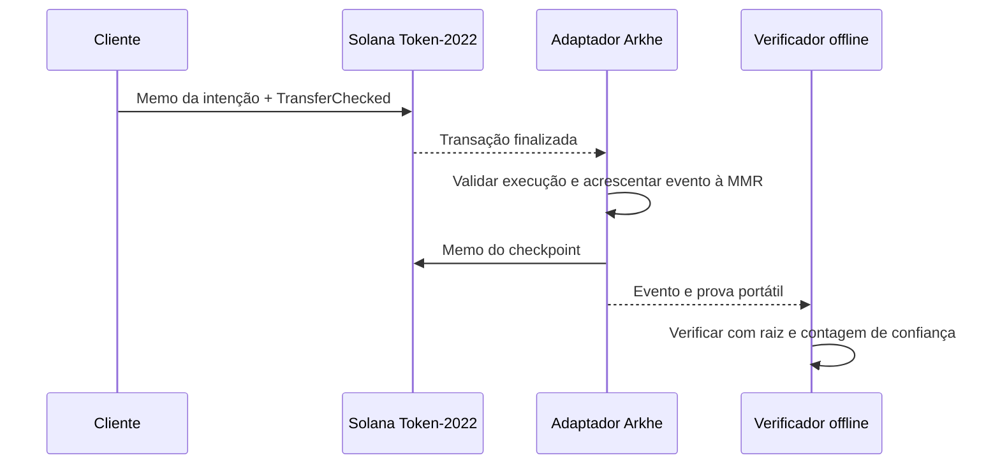

# ARKHE / Solana — especificação do protótipo v0.1

Data da revisão: 23/10/2026. Status: experimental; não é especificação de lançamento.

Adendo de testes pré-lançamento: scanner de blocos, journal SQLite experimental,
checkpoint Ed25519 e airdrop MMR foram exercitados como adaptadores locais.
Foi detectada incompatibilidade entre reservar 100% do supply em airdrop/LP/
tesouro/equipe e vender uma parcela adicional na DBC. [Resultados e bloqueios](PRELAUNCH.md).

Adendo de implementação: o fluxo Meteora DBC → compra/venda → DAMM v2 →
compra/venda → verificação Arkhe passou em validator local com binários oficiais
de teste fixados por hash. [Cenário, esquema de eventos e limites](METEORA.md).
As restrições de produção desta especificação continuam aplicáveis.

## Parecer de viabilidade

É viável usar Solana como transporte público de compromissos criptográficos do
Arkhe, com Token-2022 para emissão experimental e correlação de pagamentos.
O texto original mistura inclusão, completude, autenticidade, autorização e
solvência. São propriedades distintas. A implementação não promete confiança
global em carteiras, ausência de fraude ou valorização do token.

| Proposta original | Parecer e correção |
|---|---|
| `MemoTransfer` obriga todas as transferências do mint | Incorreto. É extensão da conta destinatária, controlada pelo dono. Não valida esquema, hash ou inclusão. |
| Memo contém prova da própria transferência já incluída | Circular se a folha contém a assinatura/resultado da transação. Usar compromisso da intenção antes e recibo de execução depois. |
| MMR prova que nenhuma operação foi omitida | Inclusão prova pertinência relativa a uma raiz. Completude exige indexação reconciliada com a cadeia; evolução append-only exige provas de consistência ou reprodução do histórico. |
| Ausência de inclusão prova transação suspeita | Ausência de resposta não é prova de não inclusão numa MMR. Exigiria estrutura indexada adicional, universo definido e mecanismo de contestação. |
| Checkpoint prova que código do token não mudou | Um hash compromete bytes identificados. Mint é estado de um programa compartilhado. Código, upgrade authority, mint/freeze authorities e metadados devem ser avaliados separadamente. |
| Metadados on-chain tornam URI imutável | Estado e conteúdo servido pela URI podem mudar. Publicar digest do conteúdo e declarar/revogar autoridades quando aplicável. |
| Memo revela origem legítima dos fundos | Não verifica identidade, intenção, legitimidade ou histórico completo do titular. |
| Toda prova válida deve receber recompensa | Permite drenagem com provas repetidas ou triviais. Recompensar achados únicos, com adjudicação, orçamento, proteção Sybil e replay. |
| Token-2022 funciona em qualquer launchpad/DEX | Compatibilidade depende de produto, extensão, conta e fluxo. Não há promessa de suporte a Pump.fun, LetsBONK.fun, Orca, Raydium ou Phantom neste protótipo. |
| Transparência mitiga volatilidade | Facilita auditoria; não limita concentração, manipulação, perdas, baixa liquidez ou volatilidade. |

As estatísticas de participação, regras de alocação e alegações de pioneirismo
do material recebido não vieram acompanhadas de fontes. Foram removidas dos
requisitos. O parecer não depende dessas alegações comerciais.

## Decisões consolidadas

1. Preservar Arkhe MMR Profile v1: BLAKE3-256, domínio de folha `00`, nó `01`,
   bag `02`, tamanho `2*n - popcount(n)` em u64 big-endian e bagging da direita
   para a esquerda. Não criar uma árvore SHA-256 com o nome WormGraph.
2. Reutilizar `verification/crates/arkhe-verify-wasm/pkg` para hash e verificação.
   O construtor JavaScript é um adaptador experimental testado contra os vetores
   congelados do repositório. Ele não grava no serviço WormGraph em produção.
3. Usar modo observador: aplicação correlaciona transferências, produz recibos
   e publica checkpoints. Um cliente pode ignorá-la. Cobertura global é falsa.
4. Não implementar Transfer Hook neste estágio. Para imposição no mint seria
   necessário programa próprio com contas auxiliares, política de upgrades,
   autorização de intenção, prevenção de replay e avaliação de composição com
   DEXs. Um wrapper opcional não impede transferências diretas do mint.
5. Token experimental `ARKHE TEST / ARKHET`, seis casas, unidades inteiras u64.
   A emissão de teste não representa a distribuição econômica proposta.
6. Executor aceita somente RPC local ou devnet oficial, usa chave efêmera e
   faucet. Não carrega carteira pessoal nem publica em mainnet.

## Protocolo v1

Codificação dos eventos: UTF-8 de arrays JSON posicionais compactos, sem espaços
adicionais, conforme `JSON.stringify`. Campos textuais aceitam somente ASCII
alfanumérico, `_` e `-`, entre 1 e 96 caracteres. Valores monetários são strings
decimais positivas canônicas, sem zero inicial, limitadas a u64. Casas decimais
são inteiros entre 0 e 255. Não usar JSON arbitrário como representação assinada.

Intenção:

```text
["arkhe-solana-intent/v1", genesisHash, mint, sourceTokenAccount,
 destinationTokenAccount, amountBaseUnits, decimals, operationId]
```

O cluster é identificado pelo genesis hash no executor real. `source` e
`destination` são contas de token, não endereços de identidade. O caso sintético
usa identificadores fictícios explícitos. A chave que autoriza a transferência
é validada pelo Token-2022, não pela validação lexical do adaptador.

Memo imediatamente anterior ao `TransferChecked`:

```text
ARKHE:v1:intent:<BLAKE3(bytes_da_intencao), hex minusculo>
```

Após finalização, produzir a folha:

```text
["arkhe-solana-event/v1", memoDaIntencao, assinaturaBase58, slot,
 arrayDaIntencao]
```

A assinatura não participa do compromisso anterior: não há autorreferência.
O slot representa ordenação da cadeia, não um timestamp civil exato. O executor
controlado envia uma única transferência por transação. Um indexador genérico
deverá acrescentar índices de instrução e CPI, além de validar logs, programa,
mint, contas, saldos e resultado finalizado. O esquema atual não é adequado a
transações arbitrárias contendo múltiplas transferências.

Recibo `arkhe-solana-receipt/v1`: intenção, assinatura, slot, `leafCount`,
`rootHex` e `proof` com passos `{kind, direction, hash: [32 bytes]}`. A API
retorna apenas inclusão; não afirma posição da folha. O consumidor fornece
raiz E contagem por canal de confiança independente. Aceitar a raiz do próprio
recibo como confiança faria qualquer histórico inventado parecer legítimo.

Checkpoint publicado em Memo:

```text
ARKHE:v1:checkpoint:<leafCount>:<rootHex>
```

Cada raiz representa o prefixo cumulativo de eventos aceitos naquele log, não
somente o lote desde a última raiz. Múltiplos logs/mints devem ter raízes de
confiança separadas. O transporte mínimo não autentica o operador por si só.
Para operação pública, fixar emissor autorizado, domínio do log, perfil, rede,
mint, sequência, contagem, raiz anterior e política de finalização num envelope
assinado. Ancorar o digest desse envelope é uma evolução versionada necessária.

## Fluxo e garantias



| Resultado | O que estabelece | O que não estabelece |
|---|---|---|
| Inclusão WASM válida | Bytes do evento pertencem ao compromisso fornecido | Que o evento ocorreu na Solana |
| Consulta RPC finalizada | RPC relata execução finalizada com aquele resultado | Prova offline do consenso Solana |
| Memo de checkpoint | Publicação de bytes pela transação consultada | Autoridade ou honestidade do publicador |
| MetadataPointer + TokenMetadata | Nome, símbolo, URI e autoridades no mint | Integridade permanente do JSON remoto |

Provas portáteis continuam verificáveis enquanto os bytes, perfil e raiz de
confiança forem preservados. Disponibilidade do conjunto completo e legitimidade
da raiz não são fornecidas pela MMR. Hashes públicos também podem permitir
correlação; não publicar faturas ou dados pessoais nos memos.

## Economia e comunidade: proposta, sem execução

Para eliminar as duas versões conflitantes do documento, conservar como hipótese
de discussão a versão 60% comunidade, 20% liquidez, 15% tesouro e 5% equipe
(total 100%). Supply total, destinatários, curva de distribuição e governança
permanecem pendentes; nenhuma distribuição foi implementada.

Vesting proposto: 24 meses desde T0, cliff de seis meses; definir explicitamente
se o cliff libera valores acumulados. Exigir escrow executável e auditoria antes
de alegar bloqueio. Ancorar um recibo não bloqueia tokens ou LP. Tesouro deve
ter multisig, política de despesas e limites. Evitar chamar a alocação de equipe
e tesouro de ausência de controle do projeto.

Quests de aprendizagem podem usar pontos sem valor financeiro nesta fase.
O Verifier Challenge será um programa de achados verificáveis, não pagamento
ilimitado por inclusão correta. Critérios necessários: identificador único,
severidade, adjudicação, orçamento, expiração, proteção contra repetição e
revisão de falsos positivos antes de introduzir apostas ou recompensas.

## Critérios de aceite e próximos marcos

- P0: gerar recibos sintéticos, confirmar compatibilidade com os vetores MMR,
  rejeitar adulteração e montar corretamente Memo + TransferChecked.
- P1: em validator local/devnet, criar mint com metadados e conta com MemoTransfer;
  rejeitar transferência sem memo; aceitar memo arbitrário; demonstrar desativação
  pelo dono; enviar transferência com intenção e ancorar seu checkpoint.
- P2: indexador real com reconciliação de slots/transações, deduplicação de
  assinatura + índice, falhas/reorganizações, persistência append-only, exportação
  de provas, checkpoints autenticados e provas de consistência.
- P3: testes específicos de wallet/DEX/launchpad, revisão das autoridades,
  supply e vesting executáveis, revisão independente e decisão de lançamento.

O cronograma comercial original de 12 semanas foi substituído por esses critérios.
DAO, airdrop, LP, lançamento público, indexador contínuo e Transfer Hook não fazem
parte da entrega P0/P1.

## Fontes primárias consultadas

- [Solana: Memo Transfer](https://solana.com/docs/tokens/extensions/memo-transfer)
- [Solana: Transfer Hook](https://solana.com/docs/tokens/extensions/transfer-hook)
- [Solana: Metadata Pointer e Token Metadata](https://solana.com/docs/tokens/extensions/metadata)
- [Token-2022: guia de extensões](https://www.solana-program.com/docs/token-2022/extensions)
- [Token-2022: guia para wallets e validator local](https://www.solana-program.com/docs/token-2022/wallet)
- Perfil e vetores internos: `verification/vectors/mmr/mmr-profile-v1.json`
  e `verification/vectors/mmr/{1,3,4,5,7}-leaves.json`.

Fontes consultadas em 23/10/2026; suporte de terceiros deve ser revalidado no
produto e versão usados antes de qualquer lançamento.
